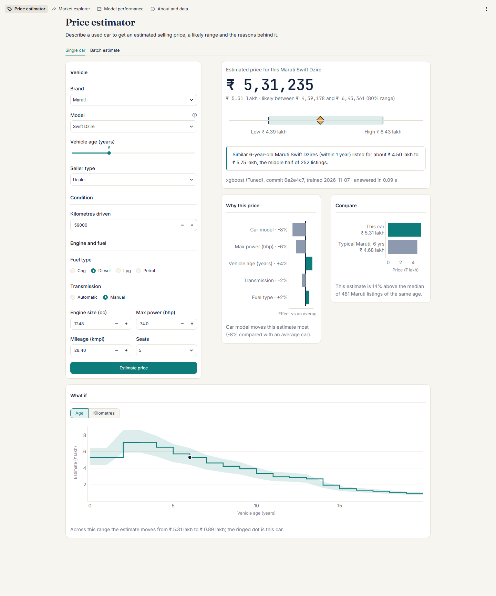
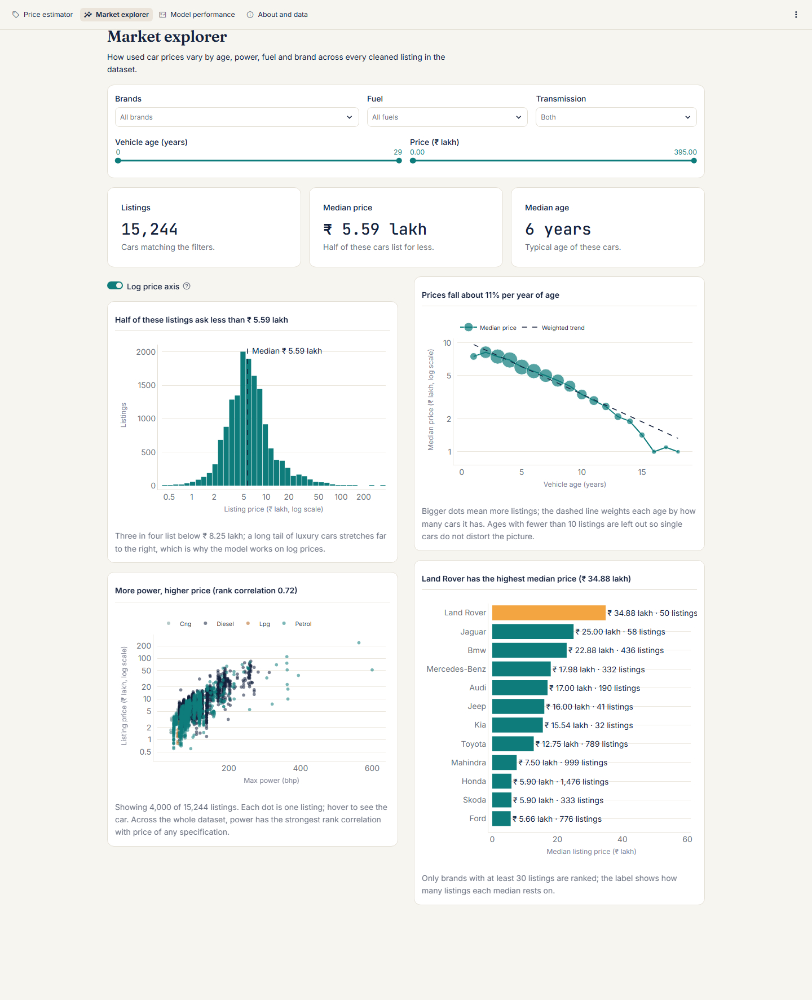
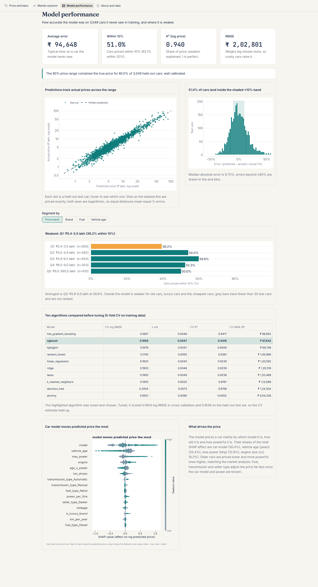

# Used Car Price Prediction System

Estimate the listing price of a used car in India, with an 80% price range and a plain-language explanation, from eleven details anyone can read off the car: brand, model, age, kilometres driven, seller type, fuel, transmission, mileage, engine size, power and seats.

An academic machine learning project: documented data cleaning, a full exploratory analysis, ten algorithms compared without leakage, a tuned XGBoost pipeline evaluated once on a locked test set, and a four-page Streamlit application.



---

## Problem statement

Used car prices in India depend on many interacting factors, and private buyers and sellers have few objective reference points. Given a car's specification, the system predicts its selling price in rupees (a regression problem), states a range the price is likely to fall in, explains which inputs moved the estimate, and warns when the car belongs to a group the model prices poorly.

The project is assessed on four requirements: (1) data cleansing and pre-processing with justified decisions, (2) a complete EDA, (3) suitable algorithms built and tuned without leakage, and (4) proper evaluation, prediction results and a GUI. `reports/requirements_traceability.md` maps each one to the files that demonstrate it.

## Results

Scored once on 3,049 held-out cars that played no part in training or tuning [`reports/tables/test_metrics.csv`]:

| Metric | Final model (tuned XGBoost) | Ridge baseline | Dummy (train median) |
|---|---|---|---|
| Mean absolute error (₹) | **94,648** | 1,15,850 | 3,85,255 |
| Within 10% of the true price | **50.97%** | 42.93% | 14.43% |
| Within 20% of the true price | **82.09%** | 75.11% | 29.94% |
| Median absolute % error | 9.75% | 12.04% | 37.08% |
| RMSE (₹) | 2,02,801 | 2,66,575 | 8,07,416 |
| R² on log price | 0.9399 | 0.9216 | -0.0036 |

- The 80% price range contains the true price for **79.96%** of test cars: well calibrated overall [`interval_coverage.csv`].
- Test log RMSE 0.1648 matches the cross-validation estimate of 0.1654, so the model is not overfitted [`train_vs_test.csv`].
- The model is weakest for cars 9 or more years old, luxury cars above ₹ 20 lakh and the cheapest cars [`segment_errors.csv`]; the app warns in words when a car falls into one of these groups.

The full write-up is in `reports/final_report.md` (also `.docx` and `.pdf`).

## Screenshots

| Market explorer | Model performance |
|---|---|
|  |  |

Dark mode follows the system setting (`reports/figures/gui_*_dark.png`); narrow-screen layouts are in `reports/figures/gui_*_narrow.png`.

## Install

Requirements: **Python 3.11** and Git. Chrome or Edge is needed only for regenerating screenshots and the PDF report.

```bash
git clone <repository-url> used-car-price-predictor
cd used-car-price-predictor

# with make (Linux, macOS, or Windows with GNU make from MSYS2/Git for Windows):
make setup

# without make (any platform), using a Python 3.11 interpreter:
python tasks.py setup            # Windows: py -3.11 tasks.py setup
```

`setup` creates `.venv/` and installs the pinned `requirements.txt`. Later commands use `.venv` automatically.

## Run

```bash
make all      # clean data, EDA figures, split, train, evaluate, prediction reports
make test     # pytest suite
make app      # Streamlit app at http://localhost:8501
```

Every `make` target has a `python tasks.py <target>` equivalent:

| Target | What it does | Writes |
|---|---|---|
| `clean-data` | Audit the raw CSV, apply the cleaning rules | `data/interim/cars_clean.csv`, `reports/tables/audit_*.csv`, `cleaning_log.csv` |
| `eda` | EDA figures and tables | `reports/figures/eda_*.png`, `reports/tables/eda_*.csv` |
| `split` | Stratified 80/20 split, feature screening | `data/processed/`, `feature_checks.csv` |
| `train` | CV benchmark, Optuna tuning, final fit, encoder comparison | `models/*.joblib`, `model_card.json`, `cv_results.csv`, `tuning_trials_*.csv` |
| `evaluate` | Score the locked test set, segments, bootstrap, permutation importance, SHAP | `test_metrics.csv` and the other evaluation tables, `eval_*` and `shap_*` figures |
| `predict` | Input schema, worked examples, what-if, timing | `reports/predictions/`, `models/input_schema.json`, `models/model_specs.csv` |
| `facts` | Derived figures quoted in the report | `reports/tables/report_key_figures.csv` |
| `notebooks` | Re-execute the three notebooks in place | `notebooks/*.ipynb` outputs |
| `all` | All of the above, in order | |
| `app` | Launch the GUI | |
| `test` / `coverage` | pytest, optionally with coverage of `src/carprice` | |
| `lint` | `ruff check` and `ruff format --check` on the whole repository | |
| `report` | Export the final report to Word and PDF | `reports/final_report.docx`, `.pdf` |
| `clean` | Delete caches and generated data (never the raw CSV) | |

The make targets build missing prerequisites, so `make test` or `make app` on a fresh clone first produces the cleaned data, the split and the model. The trained `.joblib` files and the generated data are not committed. Run times on the development laptop are in `reports/reproducibility_check.md`.

Predict a single car from the command line (invalid input prints plain-language problems and exits with code 2):

```bash
python -m carprice.predict one --brand Hyundai --model I20 --vehicle-age 4 --km-driven 45000 \
  --seller-type Dealer --fuel-type Petrol --transmission-type Manual --mileage 18.6 \
  --engine 1197 --max-power 82 --seats 5
python -m carprice.predict batch --csv cars.csv --out priced.csv
```

(Run from the project root with the `.venv` interpreter and `PYTHONPATH=src`.)

## Reproduce each requirement

| Requirement | Commands | Evidence to open |
|---|---|---|
| 1. Cleansing and pre-processing | `make clean-data split` | `notebooks/01_data_audit.ipynb`, `reports/tables/cleaning_log.csv`, `decisions.md` D-003 to D-008 |
| 2. Exploratory data analysis | `make eda` | `notebooks/02_eda.ipynb`, `reports/eda_findings.md`, `reports/figures/eda_*.png` |
| 3. Algorithms, building, tuning | `make train` | `reports/tables/cv_results.csv`, `tuning_trials_*.csv`, `models/model_card.json`, D-013 to D-020 |
| 4a. Evaluation and prediction results | `make evaluate predict` | `notebooks/03_model_evaluation.ipynb`, `reports/evaluation_summary.md`, `reports/predictions/` |
| 4b. GUI | `make app` | the running app, `reports/demo_script.md`, `reports/figures/gui_*.png` |

All settings live in `configs/config.yaml`, and one global seed (42) is passed to every splitter, model and sampler, so re-running gives the same numbers; only timings differ between machines. The clean-clone check, with the commands, run times and a file-by-file comparison against the committed results, is in `reports/reproducibility_check.md` (`scripts/compare_runs.py` performs the comparison).

To re-execute the three notebooks in place (after `make all`; they only read saved outputs and call `src/carprice`):

```bash
make notebooks                   # or: python tasks.py notebooks
```

## Export the report

```bash
make report                      # or: python tasks.py report
```

This runs `scripts/export_report.py`, which uses the pandoc binary bundled in `pypandoc_binary` (in `requirements.txt`). With a system pandoc and Chrome, the equivalent commands are:

```bash
cd reports
pandoc final_report.md -o final_report.docx --toc --toc-depth=2 --number-sections --resource-path=.
pandoc final_report.md -o final_report.html --standalone --embed-resources --mathml \
  --toc --toc-depth=2 --number-sections --resource-path=. --css=../scripts/report_print.css
chrome --headless=new --no-pdf-header-footer --print-to-pdf=final_report.pdf final_report.html
```

Every number in the report is checked against the saved tables by `tests/test_provenance.py`; Appendix D of the report lists each number's source file and is regenerated with `python -m carprice.provenance reports/final_report.md`.

## Quality

```bash
make test        # pytest
make coverage    # pytest with coverage of src/carprice
make lint        # ruff check + ruff format --check on the whole repository
```

## Folder structure

```text
.
├── AGENTS.md                 project brief and rules
├── decisions.md              decision log D-001 onwards, with contents table and open questions
├── CHANGELOG.md              release notes
├── README.md                 this file
├── UI_GUIDELINE.md           GUI work order (Phase 7)
├── Makefile, tasks.py        task runners (identical targets)
├── requirements.txt          pinned dependencies
├── pyproject.toml            ruff and pytest settings
├── configs/config.yaml       every path, seed, threshold, grid and search space
├── data/
│   ├── raw/                  read-only cardekho_dataset.csv
│   ├── interim/              cars_clean.csv (generated)
│   └── processed/            train.csv, test.csv (generated), split_indices.json
├── src/carprice/
│   ├── config.py             typed settings from the YAML
│   ├── data.py               load, validate, audit, clean
│   ├── viz.py, palette.py    shared plotting style, EDA figures, colour tokens
│   ├── features.py           split, engineered features, ColumnTransformer
│   ├── train.py              CV benchmark, Optuna tuning, final pipeline
│   ├── evaluate.py           test metrics, segments, bootstrap, permutation, SHAP
│   ├── eval_plots.py         evaluation and SHAP figures
│   ├── predict.py            validated PricePredictor, CLI
│   ├── insights.py           per-car explanation, what-if, spec lookup
│   ├── prediction_reports.py Phase 6 output files and timing
│   ├── formatting.py         ₹ and lakh formatting
│   ├── market.py             market summaries for the GUI
│   ├── report_facts.py       derived figures quoted in the report
│   └── provenance.py         number-to-source checks for written documents
├── app/
│   ├── Home.py               entry point and price estimator
│   ├── pages/                market explorer, model performance, about and data
│   └── components/           theme.css, palette, UI pieces, charts, loaders, batch checks
├── .streamlit/config.toml    light and dark themes
├── models/                   final_pipeline.joblib (generated), model card, schema, specs
├── notebooks/                01 data audit, 02 EDA, 03 model evaluation
├── reports/
│   ├── final_report.md/.docx/.pdf, viva_notes.md, demo_script.md
│   ├── requirements_traceability.md, reproducibility_check.md
│   ├── eda_findings.md, evaluation_summary.md
│   ├── figures/              every figure (EDA, evaluation, SHAP, GUI screenshots)
│   ├── tables/               every table as CSV
│   └── predictions/          test predictions, worked examples, what-if grid
├── scripts/                  capture_screenshots.py, export_report.py, compare_runs.py
└── tests/                    pytest suite
```

## Known limitations

- **No condition, accident history, ownership, city, trim or variant in the data.** These explain most of the remaining error.
- **Old cars:** only 32.74% of cars 12+ years old are priced within 10%, and the 80% range covers 52.38% of them [`segment_errors.csv`].
- **Luxury and cheapest cars:** above ₹ 20 lakh the model under-prices by a median 5.76%; the cheapest fifth is over-priced by 7.26%.
- **Rare brands and fuels** (for example LPG) have too little data to price or evaluate reliably; brands absent from training are refused.
- **Listing prices from one platform and one period**, not final sale prices; prices drift over time.
- Full list: `decisions.md` D-026 and D-042, and Chapter 9 of the final report.

## Data source and licence

The dataset (`data/raw/cardekho_dataset.csv`) consists of used car listings from CarDekho, used here **for academic purposes only**. All rights to the data remain with their owners; it is not redistributed for any other purpose and contains no personal information about sellers. The code was written for an academic project and carries no warranty; price estimates are guidance, not valuations.
