# Abstract {.unnumbered}

This project builds a system that estimates the selling price of a used car in India from eleven specifications a seller or buyer can read off the car: brand, model, age, kilometres driven, seller type, fuel, transmission, mileage, engine size, power and seats. The data are 15,411 CarDekho listings. After a documented cleaning process that removed 167 exact duplicates and repaired 18 implausible values (2 seat counts, 4 fuel labels and 12 odometer readings), 15,244 listings remained. A stratified 80/20 split locked away 3,049 cars as a test set before any model or encoder was fitted. Ten algorithms were compared by five-fold cross-validation on the training split; the three gradient-boosting models were tuned with Optuna, and a tuned XGBoost pipeline that predicts log price was selected on cross-validated log RMSE alone (0.1654). [Sources: `report_key_figures.csv`, `cleaning_log.csv`, `test_metrics.csv`, `configs/config.yaml`, `models/best_params.json`.]

Scored once on the locked test set, the model is off by **₹ 94,648** on average (95% bootstrap interval ₹ 88,440 to ₹ 1,01,444) and prices **50.97%** of cars within 10% and **82.09%** within 20% of their listed price. That is an 18.30% lower average error than a Ridge regression baseline. Its 80% price range contains the true price for **79.96%** of test cars, so the interval is well calibrated on average. The model is weakest for cars 9 or more years old, for luxury cars above ₹ 20 lakh and for the cheapest cars. A four-page Streamlit application exposes the model with plain-language explanations and warnings for those weak segments. [Sources: `test_metrics.csv`, `bootstrap_ci.csv`, `report_key_figures.csv`, `interval_coverage.csv`.]

Every number in this report is read from a file in `reports/tables/`, `reports/predictions/`, `models/` or `configs/config.yaml`; Appendix D lists each number with its source file.

# Introduction and problem definition

## Motivation

The used car market in India is large and informal. A private seller listing a car, or a buyer comparing listings, has few objective reference points: two cars of the same model can differ in age, kilometres, fuel, gearbox and seller, and each of these moves the price. A data-driven estimate with an honest range gives both sides a starting point for negotiation and flags listings that look unusually cheap or expensive.

## Problem statement

Given the specification of a used car, estimate its selling price in Indian rupees, together with a range that the true price is likely to fall in, and explain which inputs moved the estimate. This is a supervised regression problem. The target is the listed selling price (`selling_price`), and the inputs are eleven fields that a non-expert can supply.

## The four requirements

The project is assessed against four requirements. Each is restated here with the chapter that answers it; `reports/requirements_traceability.md` maps each to the exact files.

1. **Data cleansing and pre-processing**, with every cleaning decision justified (Chapter 3).
2. **A complete exploratory data analysis** at univariate, bivariate and multivariate level, with written interpretation (Chapter 4).
3. **Suitable algorithms**, built and tuned in a defensible, leak-free way (Chapter 5).
4. **Evaluation with proper metrics, prediction results and a GUI** that demonstrates them (Chapters 6, 7 and 8).

## Objectives

- Produce a cleaned dataset from the read-only raw file, with each rule logged and its effect counted.
- Explain the market structure and the drivers of price before modelling, and use that to choose the target transformation, features and algorithms.
- Compare a diverse set of algorithms fairly, tune the best, and select a final model using training data only.
- Measure accuracy once on a locked test set, with metrics a car buyer understands, uncertainty intervals and a breakdown by segment.
- Deliver an application that a non-technical person can use, which explains each estimate and warns when the model is unreliable.

## Scope

In scope are the eleven input fields of the CarDekho dataset, point estimates with an 80% range, per-car explanations and a GUI that runs locally. Out of scope are features not in the data (city, condition, accident and ownership history, trim and variant), real transaction prices (the target is a listing price), deployment to a public server and any retraining after the test set was used.

## Approach and tools

All reusable logic lives in the Python package `src/carprice/`, configured by `configs/config.yaml` with one global random seed (42). Notebooks only display results. The tools are `pandas` and `numpy` for data, `matplotlib` and `seaborn` for static figures, `scikit-learn`, `XGBoost` and `LightGBM` for models, `Optuna` for tuning, `SHAP` and permutation importance for explanation, `joblib` for persistence, `Streamlit` with `plotly` for the GUI, and `pytest` and `ruff` for quality. Every non-trivial choice is recorded in `decisions.md` as a numbered entry (D-001 onwards); this report cites those numbers in brackets.

# Dataset description

## Source

The dataset is the CarDekho used car listings file, `data/raw/cardekho_dataset.csv`, used here for academic purposes only. It is treated as read-only: no step in the project writes to it (D-002). Each row is one listing on the CarDekho platform.

## Size and columns

The raw file has **15,411 rows and 14 columns**, with no missing values [`cleaning_log.csv`, `report_key_figures.csv`, `audit_schema.csv`]. The table below describes the columns.

| Column | Type | Unit or values | Notes |
|---|---|---|---|
| `Unnamed: 0` | integer | row id | Index left over from an export; not a feature |
| `car_name` | text | brand + model | Exactly `brand` + " " + `model` on every row |
| `brand` | text | 32 raw values | Manufacturer |
| `model` | text | 120 values | Model line, e.g. "City", "Swift Dzire" |
| `vehicle_age` | integer | years, 0 to 29 | Age at the time of listing |
| `km_driven` | integer | kilometres | Odometer reading |
| `seller_type` | text | Dealer, Individual, Trustmark Dealer | Sales channel |
| `fuel_type` | text | Petrol, Diesel, CNG, LPG, Electric | Fuel |
| `transmission_type` | text | Manual, Automatic | Gearbox |
| `mileage` | decimal | kmpl (km/kg for CNG) | Rated fuel economy |
| `engine` | integer | cc | Engine displacement |
| `max_power` | decimal | bhp | Peak power |
| `seats` | integer | seats | Seating capacity |
| `selling_price` | integer | ₹ | Listed price; the prediction target |

: Raw columns [`audit_schema.csv`, `audit_numeric_summary.csv`]

## Initial observations

The Phase 1 audit (`notebooks/01_data_audit.ipynb`) checked schema, duplicates, distributions, categorical levels and physical plausibility. Its main observations were:

- **Price is extremely skewed.** Prices run from ₹ 40,000 to ₹ 3.95 crore with a median of ₹ 5.56 lakh [`audit_numeric_summary.csv`].
- **Odometer outliers.** The 99th percentile of `km_driven` is 1,80,000 km but the maximum is 38,00,000 km; 12 listings exceed 5,00,000 km [`audit_numeric_summary.csv`, `audit_logical_checks.csv`].
- **Impossible seat counts.** Two listings have `seats = 0` [`audit_seats_anomalies.csv`].
- **Mislabelled fuel.** Four listings are labelled `Electric`, but all four are Toyota Camry cars with a 2,494 cc engine and 157.7 bhp, which identifies them as petrol hybrids [`audit_electric_rows.csv`].
- **Duplicates.** Ignoring the row id and the redundant `car_name`, 167 rows (1.084%) are exact copies of another row, and 2,148 rows share all specifications with another row but have a different price [`audit_duplicates.csv`].
- **Imbalanced categories.** Dealers list 9,539 cars and individuals 5,699; manuals make up 79.326% of listings; LPG (44 rows) and Electric (4 rows) are rare [`audit_categorical_frequencies.csv`].
- **Other plausibility checks** flag listings that are genuine rather than errors: 5 cars aged 0 years, 13 cars averaging more than 1,00,000 km a year, 105 cars with mileage outside 8 to 30, 175 with unusual power per litre and 2 priced under ₹ 50,000 [`audit_logical_checks.csv`]. These were inspected and kept.

# Data cleansing and pre-processing

## Cleaning rules

Cleaning is a sequence of pure functions in `src/carprice/data.py`; each takes a DataFrame and returns a new one, and the row counts before and after are logged to `reports/tables/cleaning_log.csv`. A rule that removed more than 2% of rows would stop the pipeline (`cleaning.max_drop_row_fraction` in the config); no rule came close. The table below lists every rule.

| Rule | Rows before | Rows after | Rows affected | What it does and why |
|---|---|---|---|---|
| `drop_identifier_columns` | 15,411 | 15,411 | 15,411 | Drops `Unnamed: 0` (an export index) and `car_name` (always `brand` + `model`), D-008 |
| `normalise_text` | 15,411 | 15,411 | 3,344 | Trims spaces and title-cases categories, so "BMW" and "Bmw" become one level |
| `drop_exact_duplicates` | 15,411 | 15,244 | 167 | Keeps the first of each exact duplicate; duplicates split across train and test would leak, D-003 |
| `fix_invalid_seats` | 15,244 | 15,244 | 2 | Replaces `seats = 0` with the modal seat count of the same brand and model (5 for both), D-006 |
| `fix_fuel_labels` | 15,244 | 15,244 | 4 | Recodes the four "Electric" Camry hybrids to Petrol, D-005 |
| `treat_km_outliers` | 15,244 | 15,244 | 12 | Caps `km_driven` at 5,00,000 and adds a `km_was_capped` flag, D-004 |
| `validate_ranges` | 15,244 | 15,244 | 0 | Asserts engine, power, mileage, age and price lie in plausible ranges |

: Cleaning rules and their effect [`cleaning_log.csv`]

The cleaned file, `data/interim/cars_clean.csv`, has **15,244 rows and 13 columns** and no missing values. Only 167 rows (1.084%) were removed, all exact duplicates.

**Justifications in brief.**

- *Duplicates* (D-003): an exact copy of a listing in both training and test data lets the model "remember" the answer, which inflates test scores. Rows with identical specifications but different prices were kept, because that spread is real market variation the model must learn to live with.
- *Odometer cap* (D-004): a 3-year-old car with 38,00,000 km is a data-entry error. Capping keeps the row while limiting its leverage on linear models. Note that the `km_was_capped` flag was later found not to be an input of the final pipeline (D-024); with 12 affected rows the effect is negligible, and permutation importance confirms it carries no weight [`permutation_importance.csv`].
- *Seats* (D-006): both cars (a Honda City and a Nissan Kicks) are five-seaters by manufacturer specification; imputing from the same brand and model gives the correct value.
- *Fuel labels* (D-005): a battery electric car has no engine displacement; a four-row category would also break stratified folds.
- *Luxury cars kept* (D-007): listings up to ₹ 3.95 crore are genuine. Dropping them would improve error metrics dishonestly; instead, Chapter 6 reports accuracy by price segment.

## Train/test split

Immediately after cleaning, and before any statistic was computed for modelling, the data were split 80/20 into `data/processed/train.csv` (12,195 rows) and `data/processed/test.csv` (3,049 rows) [`models/model_card.json`, `test_metrics.csv`]. The split is stratified on five quantile bins of price, with seed 42, so that cheap, mid-range and luxury cars appear in the same proportions in both parts (D-012). The row indices are saved in `data/processed/split_indices.json`, and re-running the split reproduces it byte for byte.

The test set was then **locked**: the training code refuses to read it (`load_training_data()` raises an error, tested in `tests/test_train.py`), and it was scored exactly once, after the final model and the metrics had been fixed and committed (D-023, D-025).

## Pre-processing pipeline

Everything that learns from data is inside one scikit-learn object, so it is fitted on the training fold only, in cross-validation and in the final fit, as summarised in the diagram after the list:

1. **`TransformedTargetRegressor`** wraps the whole pipeline. It trains on `log1p(price)` and returns `expm1` of the prediction, so callers work in rupees while the loss is computed on the log scale (D-009, D-017).
2. **`DomainFeatureEngineer`** adds four measured features: `km_per_year`, `power_per_litre`, `is_luxury_brand` and `age_x_power` (see Feature screening in Chapter 5).
3. **`ColumnTransformer`** prepares three groups of columns:
   - numeric columns: median imputation (plus standard scaling for linear and distance-based models);
   - `brand`, `fuel_type`, `transmission_type`, `seller_type`: a `RareCategoryEncoder` that maps levels seen fewer than 20 times in the training fold to "Other" (D-015), then one-hot encoding that ignores unseen levels;
   - `model`: scikit-learn's `TargetEncoder` with internal five-fold cross-fitting (D-014).
4. **The estimator** (XGBoost in the final model).

```text
TransformedTargetRegressor(log1p / expm1)
└── Pipeline
    ├── DomainFeatureEngineer      km_per_year, power_per_litre, is_luxury_brand, age_x_power
    ├── ColumnTransformer
    │   ├── numeric      SimpleImputer(median) [+ StandardScaler for linear models]
    │   ├── categorical  RareCategoryEncoder(min 20) -> OneHotEncoder(ignore unknown)
    │   └── model        TargetEncoder(cross-fitted, smooth="auto")
    └── XGBRegressor (tuned)
```

*Structure of the saved pipeline, `models/final_pipeline.joblib`.*

## Leakage prevention

Leakage, where information about the test answers reaches the model during training, is the most common way a regression project reports scores it cannot repeat. It was prevented as follows:

- the split happened before any modelling statistic was computed;
- every fitted transformation is inside the pipeline, refitted on each training fold;
- the target encoder uses internal cross-fitting, so a training row's encoded value never includes its own price;
- feature screening, encoder comparison, algorithm comparison and tuning used training data only;
- the test set was read once (D-025), and no change was made after its results were seen.

Three steps do touch the full cleaned dataset; each was assessed (D-022). The seat imputation affects 2 rows and uses no price information. The brand-tier mapping in the config is derived from full-data prices but is used only for reporting, never as a model input. The list of luxury brands is fixed domain knowledge, not fitted. None of these can carry test prices into the model.

# Exploratory data analysis

The full analysis is in `notebooks/02_eda.ipynb` with the written findings in `reports/eda_findings.md`. The analysis uses the cleaned dataset; it informs choices but fits nothing that the model uses. Every figure is regenerated by `python tasks.py eda`. In Phase 8 the numbers in the EDA notes were re-checked against their tables and several were corrected (D-038); the values below are the corrected ones.

## Univariate analysis

**The target.** Selling price has a skewness of 10.11; after `log1p` the skewness is 0.56 [`report_key_figures.csv`]. The median listing is ₹ 5.59 lakh and three in four list below ₹ 8.25 lakh, while the mean (₹ 7.75 lakh) is pulled up by a long luxury tail [`eda_numeric_summary.csv`]. This is the single most consequential finding of the EDA: a model trained on raw rupees with squared error would spend most of its effort on a few hundred expensive cars.

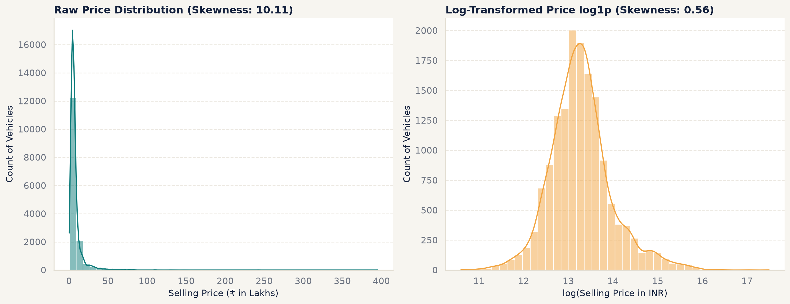

**Numeric inputs.** The median car is 6 years old with 50,000 km on the odometer [`eda_numeric_summary.csv`]. Engine size clusters at common commuter displacements, and power has a long right tail of performance cars.

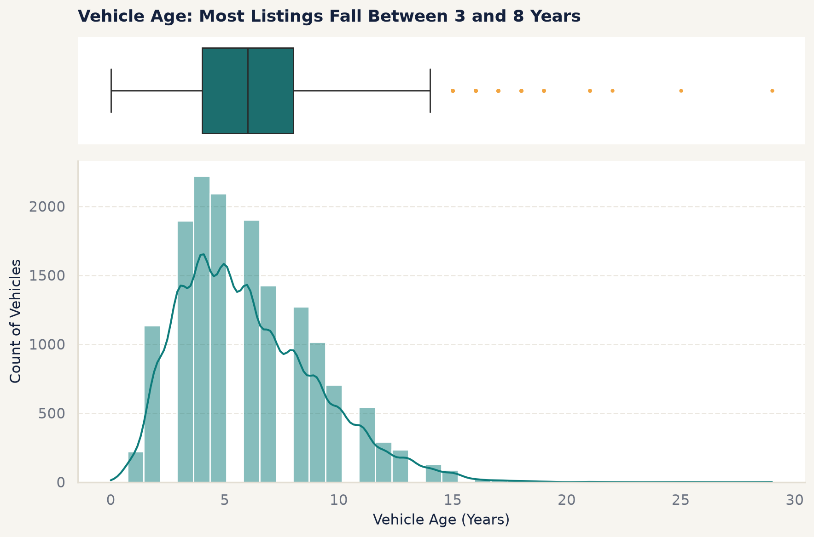

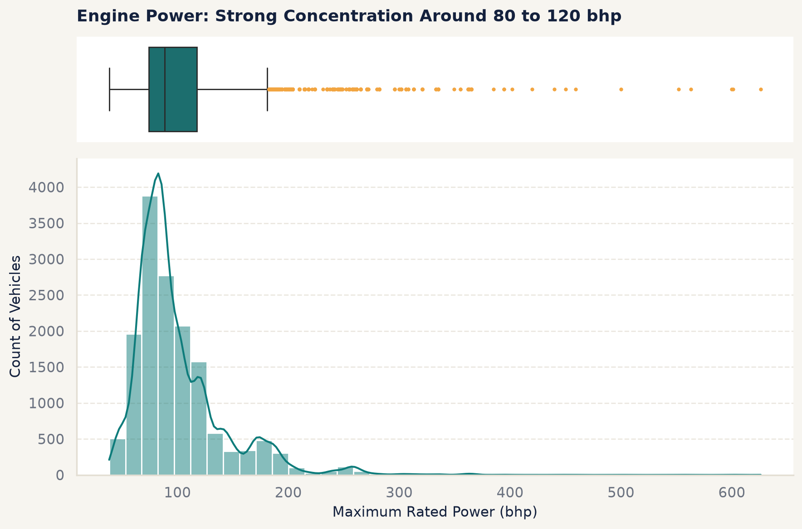

**Categorical inputs.** Maruti (32.36%) and Hyundai (19.36%) together account for 51.73% of listings; manual gearboxes 79.34%; petrol 49.59% and diesel 48.16%; five-seaters 83.76% [`report_key_figures.csv`]. The cleaned data contain 31 brands, 13 of which have fewer than 30 listings [`report_key_figures.csv`, `eda_rare_brands.csv`]. This imbalance means the model will see few examples of rare brands, which Chapter 6 confirms as a weakness.

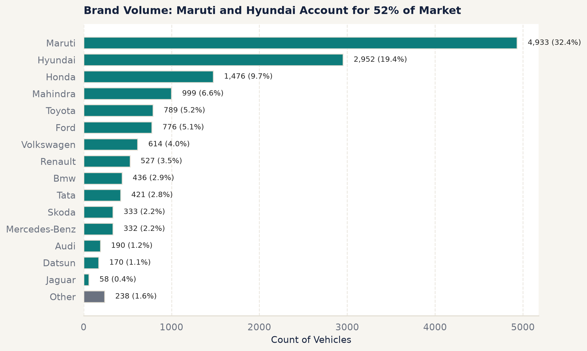

## Bivariate analysis

**Power and engine.** Power has the strongest rank correlation with price (Spearman ρ = 0.72), followed by engine size (ρ = 0.64); the Pearson correlation of power with log price is 0.76 [`eda_spearman_correlation.csv`, `eda_pearson_correlation.csv`]. The relationship is steep and curved, which favours tree models and a log target.

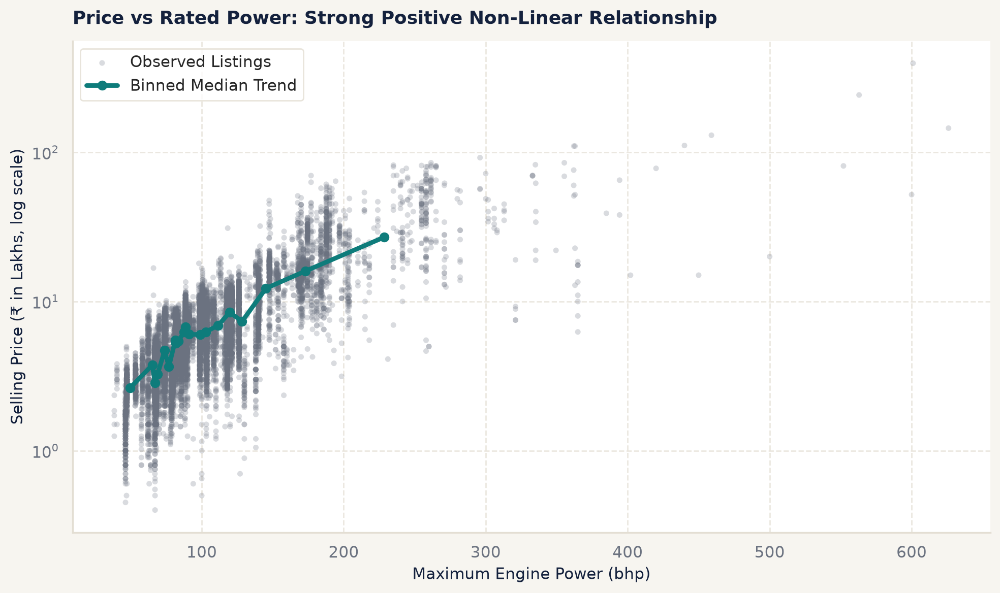

**Age.** Age is the main downward driver (ρ = -0.48) [`eda_spearman_correlation.csv`]. For the five highest-volume brands, the estimated average loss per year of age ranges from 9.39% (Mahindra) to 12.89% (Hyundai) [`eda_depreciation_rates.csv`].

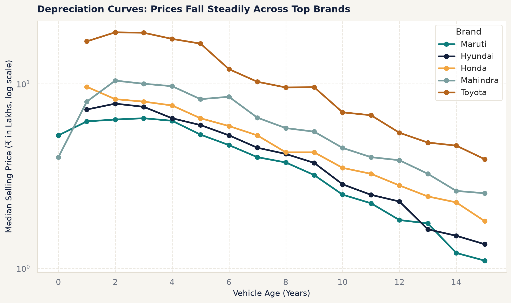

**Kilometres.** Kilometres driven correlate only weakly with price (ρ = -0.17), and strongly with age (ρ = 0.58), so much of their effect is carried by age [`eda_spearman_correlation.csv`].

**Transmission, fuel and seller.** Median prices differ sharply by transmission (automatic ₹ 10,50,000 against manual ₹ 5,00,000, a ratio of 2.10) and fuel (diesel ₹ 7,00,000 against petrol ₹ 4,60,000, ratio 1.52), and only slightly by seller (dealer ₹ 5,90,000 against individual ₹ 5,10,000, ratio 1.16) [`eda_transmission_medians.csv`, `eda_fuel_medians.csv`, `eda_seller_medians.csv`, `report_key_figures.csv`].

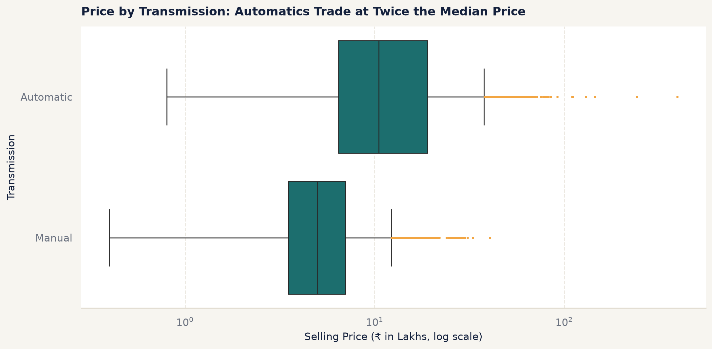

**Brand.** Brand medians span two orders of magnitude, from ₹ 3,00,000 (Datsun) through ₹ 12,75,000 (Toyota) and ₹ 22,87,500 (BMW) to ₹ 50,00,000 (Porsche) [`eda_brand_medians.csv`].

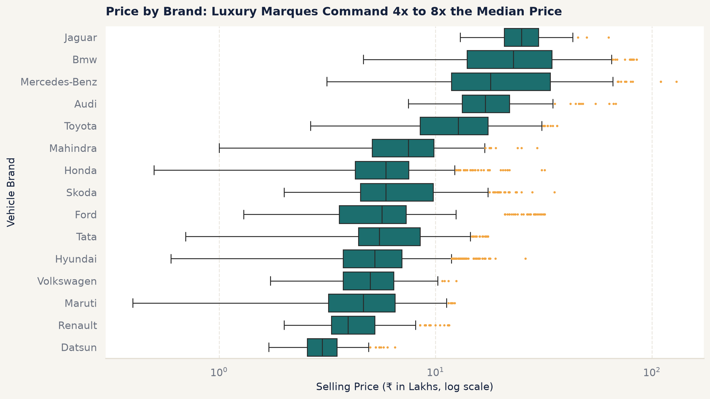

## Multivariate analysis

**Correlation and collinearity.** Engine size and power are strongly correlated (Pearson r = 0.81, Spearman ρ = 0.83). Their variance inflation factors are 6.41 and 4.56; all other numeric inputs lie between 1.43 and 2.27 [`eda_pearson_correlation.csv`, `eda_spearman_correlation.csv`, `eda_vif_summary.csv`]. This argues for regularised linear baselines and for tree ensembles, which are not harmed by correlated inputs.

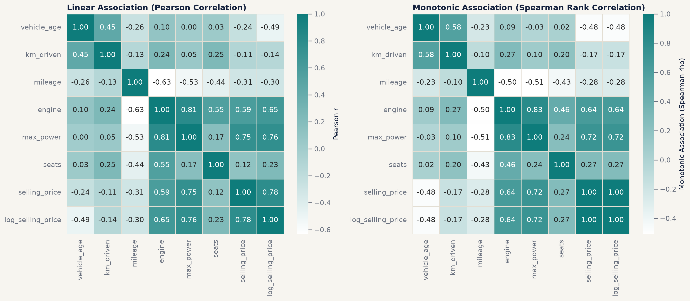

**Is the automatic premium just a power effect?** Automatics tend to be more powerful cars, so the raw ratio of 2.10 overstates the gearbox effect. Splitting the data into power quartiles and testing within each one shows that automatics remain dearer in every quartile: for example ₹ 4,49,500 against ₹ 3,40,000 in the lowest quartile (38 to 74 bhp). Mann-Whitney U tests are significant in all four quartiles (p < 0.001) with rank-biserial effect sizes from 0.26 to 0.61 [`eda_hypothesis_tests.csv`].

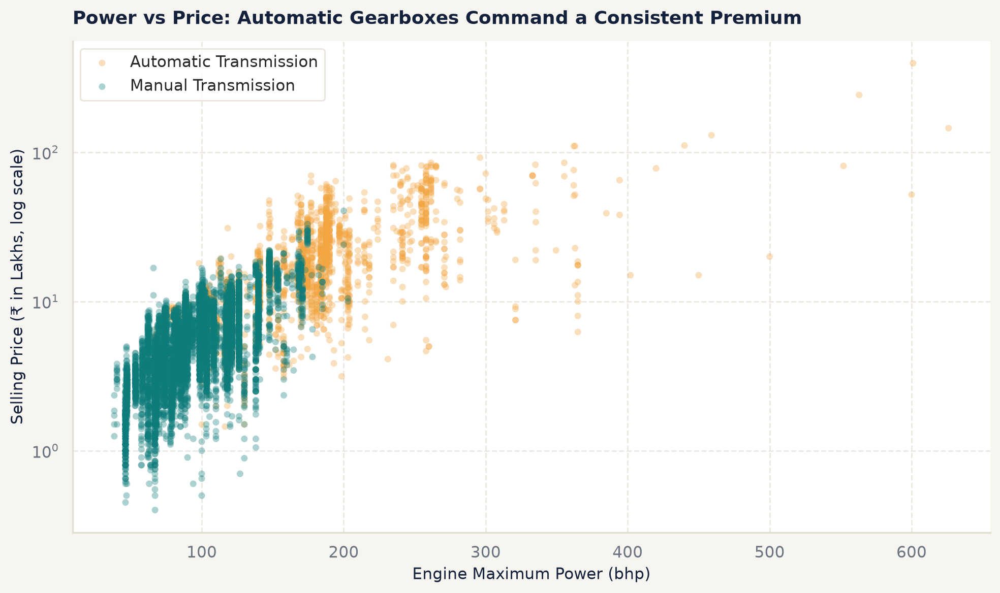

**Age by fuel.** Diesel cars list above petrol cars at every age, and the two decline at a similar rate.

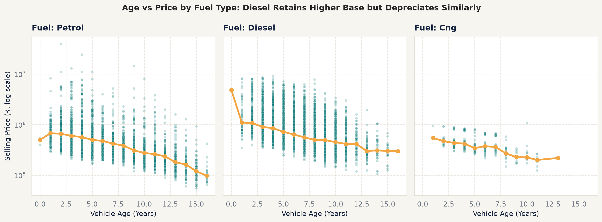

**Hypothesis tests.** Non-parametric tests were chosen because prices are not normally distributed even after transformation (D-011). In addition to the transmission tests, dealer prices exceed individual prices (Mann-Whitney U, p < 0.001, small effect size 0.18) and prices differ across diesel, petrol and CNG (Kruskal-Wallis H = 2527.5, p < 0.001, effect size 0.32) [`eda_hypothesis_tests.csv`].

**Luxury outliers.** The most expensive listings come from genuine luxury brands, which supports keeping them (D-007).

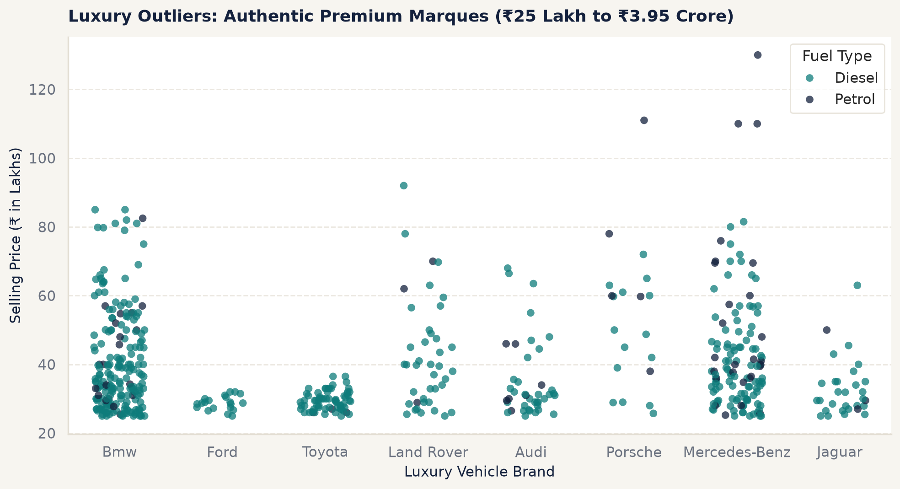

## What the EDA meant for modelling

1. Predict `log1p(price)` (D-009).
2. Propose engineered features: power per litre, kilometres per year, a luxury-brand flag and interactions. Each would be measured in Phase 3, not assumed (D-010, D-013).
3. Expect tree ensembles to do better than linear models, because the relationships are curved and interacting; keep a Ridge baseline to prove it.
4. Encode the 120-level `model` column compactly, and group rare brands (D-014, D-015).

# Algorithm selection and model building

## Cross-validation protocol

All model choices use five-fold cross-validation on the 12,195 training rows with seed 42. The main selection metric is **log RMSE**: the root mean squared error of `log1p(price)`, which is the quantity the models minimise. On the log scale an error of one tenth corresponds to a miss of roughly 10% at any price level, so expensive and cheap cars count equally.

## Feature screening

Each feature proposed by the EDA was added to a scaled Ridge "probe" model and kept only if it lowered CV log RMSE by at least 0.0001 (`feature_checks.min_rmse_gain` in `configs/config.yaml`, D-013). The table below shows the result.

| Candidate | CV log RMSE | Change vs base 0.202 | Decision |
|---|---|---|---|
| `km_per_year` | 0.2018 | -0.0002 | Keep |
| `power_per_litre` | 0.2016 | -0.0005 | Keep |
| `log_km_driven` | 0.2025 | +0.0004 | Reject |
| `is_luxury_brand` | 0.2009 | -0.0011 | Keep |
| `age_x_power` | 0.1925 | -0.0095 | Keep |
| `power_x_automatic` | 0.2021 | 0.0 | Reject |
| All kept together | 0.1903 | -0.0117 | Keep |

: Feature screening on the training split [`feature_checks.csv`]

`age_x_power` carries most of the gain: powerful cars lose value faster, which a linear model cannot express without the interaction.

For the high-cardinality `model` column, target encoding and one-hot encoding were compared (D-014). For the tuned XGBoost, target encoding was better (0.1654 against 0.1673); for the Ridge probe the result reverses (0.202 against 0.1895), because one coefficient per model gives a linear model more freedom [`encoder_comparison.csv`]. Since the deployed model is XGBoost, target encoding was kept.

## Algorithm shortlist

Ten algorithms were compared, chosen to cover different learning biases rather than to hunt for one winner (D-016) [`model_candidates.csv`]:

- **Baselines:** a dummy regressor that always predicts the training median, and ordinary least squares.
- **Regularised linear models:** Ridge (L2) and Lasso (L1), which handle the engine and power collinearity.
- **Instance-based:** k-nearest neighbours, which prices a car by similar cars.
- **Single tree:** a depth-limited decision tree, interpretable but high-variance.
- **Bagging:** a random forest, which averages many decorrelated trees.
- **Boosting:** scikit-learn's histogram gradient boosting, XGBoost and LightGBM, the usual leaders on tabular data.

## Untuned comparison

Each algorithm was run with fixed default settings from the config (`models.candidate_params`) inside the same pipeline.

| Algorithm | CV log RMSE (± std) | CV R² (log) | Out-of-fold MAE (₹) |
|---|---|---|---|
| Histogram gradient boosting | 0.1667 ± 0.0046 | 0.9417 | 98,692 |
| XGBoost | 0.1668 ± 0.0047 | 0.9416 | 97,642 |
| LightGBM | 0.1678 ± 0.0047 | 0.9409 | 99,748 |
| Random forest | 0.1745 ± 0.005 | 0.9361 | 1,00,988 |
| Linear regression | 0.1903 ± 0.0045 | 0.9239 | 1,20,592 |
| Ridge | 0.1903 ± 0.0046 | 0.9239 | 1,20,518 |
| Lasso | 0.1905 ± 0.0049 | 0.9238 | 1,20,469 |
| k-nearest neighbours | 0.1955 ± 0.002 | 0.9197 | 1,13,089 |
| Decision tree | 0.2004 ± 0.0073 | 0.9158 | 1,24,304 |
| Dummy (median) | 0.6921 ± 0.008 | -0.0052 | 4,04,328 |

: Untuned five-fold CV results on the training split [`cv_results.csv`]

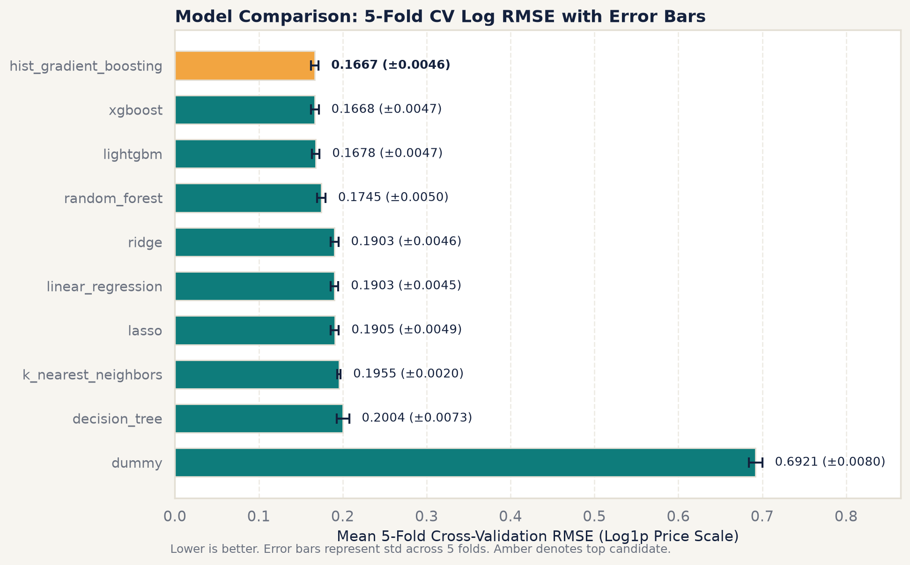

The three boosting models lead, and are within one fold standard deviation of one another. Linear models are clearly behind: they cannot represent the curved price-power relationship or the way depreciation differs between car types without hand-built interactions. A single tree overfits, and the random forest, while better, does not reach the boosters.

## Tuning

The three boosting models were tuned with Optuna's Tree-structured Parzen Estimator, **35 trials each**, seed 42, over the search spaces in `configs/config.yaml` (`models.search_spaces`) (D-018). To make tuning affordable without leakage, the preprocessing for each of the five folds was fitted once on that fold's training part and reused across trials; this is mathematically the same as fitting the full pipeline in every trial. Every trial is logged in `reports/tables/tuning_trials_*.csv`.

| Model | Best CV log RMSE after tuning |
|---|---|
| XGBoost | 0.1654 |
| LightGBM | 0.1660 |
| Histogram gradient boosting | 0.1660 |

: Best tuned scores [`models/best_params.json`]

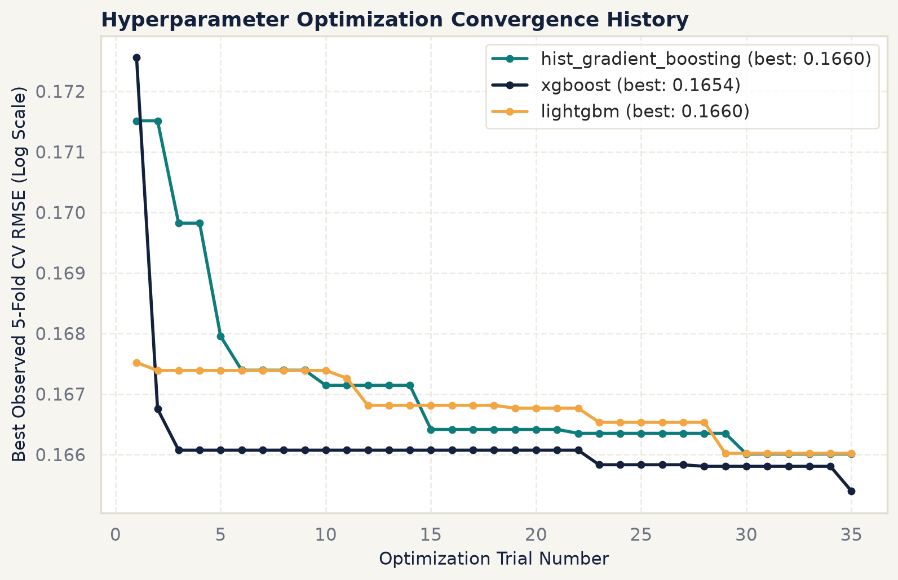

## Final model choice

The selection rule, fixed before tuning, was the lowest mean CV log RMSE, with ties broken by fold stability, simplicity and speed (D-019). **Tuned XGBoost** won with **0.1654** (out-of-fold R² 0.9426). Its tuned settings are 200 trees of depth 6, learning rate 0.05, and row and column subsampling of 0.86 and 0.68 [`models/model_card.json`]. The margin over LightGBM and histogram boosting is smaller than one fold standard deviation, so the three are effectively tied; XGBoost is chosen because the rule says so, and any of the three would have served. Against the baselines, the tuned model's CV log RMSE is 76.1% below the dummy and 13.06% below Ridge [`models/model_card.json`].

The final pipeline was refitted on all 12,195 training rows and saved with `joblib` as `models/final_pipeline.joblib`, together with a model card (`models/model_card.json`) recording the commit, training date, hyperparameters, CV scores and interval quantiles.

## Prediction interval

A point estimate alone hides how uncertain it is. The 80% range is built from the out-of-fold residuals on the log scale (D-020): their 10th and 90th percentiles are -0.1903 and 0.1915, and for a new car the range is `expm1(log prediction + q10)` to `expm1(log prediction + q90)` [`models/model_card.json`]. Because it uses residuals the model never trained on, it makes no normality assumption, and because it is additive on the log scale the range in rupees widens in proportion to price.

# Model evaluation

## Metric choice

The metrics were fixed and committed before the test set was opened, so the results could not influence which ones were reported (D-023):

- **MAE in rupees** answers "how far off, on average", in the unit users care about. It is one half of the headline.
- **Share within 10% of the true price** answers "how often is it close", independent of price level. It is the other half of the headline.
- **RMSE in rupees** shows how much of the error sits in large misses on expensive cars.
- **MAE, RMSE and R² on log price** match the training objective and are comparable with the CV scores.
- **MAPE and median absolute percentage error** describe relative error; MAPE is pulled up by cheap cars, the median is robust.
- **Adjusted R²** is reported because it was requested; with 3,049 test rows the adjustment is negligible.
- **Interval coverage** with a 95% Wilson confidence interval checks the 80% range.
- **Bootstrap 95% intervals** (1,000 resamples, seed 42) give uncertainty for the main metrics [`bootstrap_ci.csv`].

## Test results

| Metric | Final model (tuned XGBoost) | Ridge baseline | Dummy (train median) |
|---|---|---|---|
| MAE (₹) | 94,648 | 1,15,850 | 3,85,255 |
| RMSE (₹) | 2,02,801 | 2,66,575 | 8,07,416 |
| R² (₹) / adjusted | 0.9328 / 0.9319 | 0.8839 / 0.8824 | -0.0654 / -0.0654 |
| MAE (log) | 0.1247 | 0.1457 | 0.5016 |
| RMSE (log) | 0.1648 | 0.1881 | 0.6732 |
| R² (log) / adjusted | 0.9399 / 0.9391 | 0.9216 / 0.9206 | -0.0036 / -0.0036 |
| MAPE | 12.7% | 14.86% | 53.67% |
| Median absolute % error | 9.75% | 12.04% | 37.08% |
| Within 10% | 50.97% | 42.93% | 14.43% |
| Within 20% | 82.09% | 75.11% | 29.94% |
| Median signed % error (bias) | -0.34% | -0.65% | 1.08% |

: Results on the locked test set of 3,049 cars [`test_metrics.csv`]

On a typical car the model is about a tenth off: the median absolute error is 9.75%, about half of cars are within 10% and four in five are within 20%. The average miss is ₹ 94,648, with a 95% bootstrap interval of ₹ 88,440 to ₹ 1,01,444 [`bootstrap_ci.csv`].

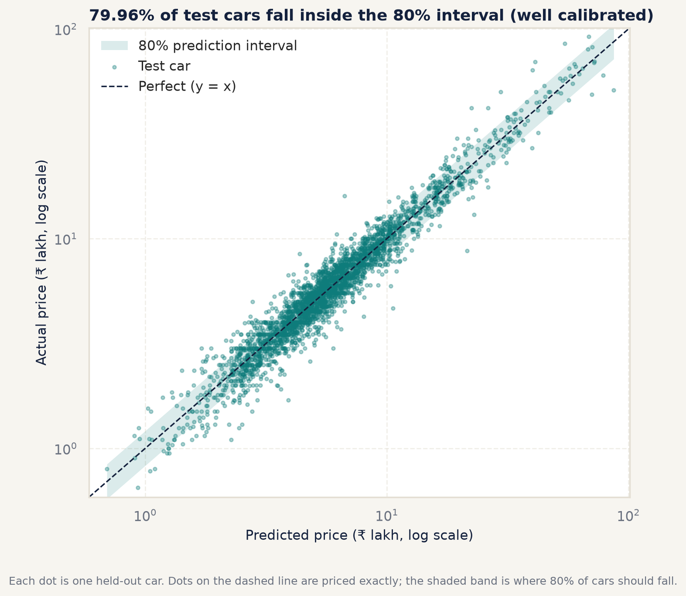

## Comparison with baselines

The final model lowers MAE by 18.30% and log RMSE by 12.39% relative to Ridge, and prices 8.04 percentage points more cars within 10% [`report_key_figures.csv`]. The bootstrap interval for the MAE difference (final minus Ridge) is -₹ 28,252 to -₹ 14,851, which excludes zero, so the improvement is not an accident of which cars ended up in the test set [`bootstrap_ci.csv`]. Against the dummy baseline, MAE is 75.43% lower [`report_key_figures.csv`].

**Why does XGBoost beat Ridge?** Three reasons, each visible in the data. Price rises non-linearly with power (Chapter 4), which a linear model on log price captures only approximately. Depreciation differs between car types (the `age_x_power` interaction gave the largest gain in feature screening), and trees learn such interactions automatically. Finally, the car model is the most important input (see Explainability below), and its effect combines with age and power in ways that a single linear coefficient per encoded model cannot express.

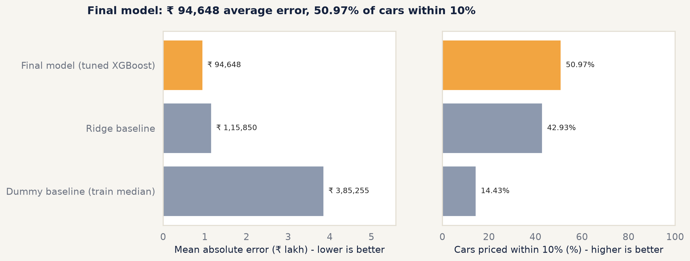

## Generalisation

| Data | Log RMSE | R² (log) |
|---|---|---|
| Training rows, in-sample fit | 0.1387 | 0.9596 |
| Training rows, five-fold out-of-fold | 0.1654 | 0.9426 |
| Test set, scored once | 0.1648 | 0.9399 |

: Training, cross-validation and test error [`train_vs_test.csv`]

The test error (0.1648) matches the cross-validation estimate (0.1654) to within 0.36% [`train_vs_test.csv`], so the CV protocol predicted test performance well and the model is not overfitted to its training folds. The tighter in-sample fit is normal for boosted trees and did not carry over into a test penalty.

## Residuals and calibration

The residuals on the log scale are centred: mean -0.0009, median 0.0034. They are slightly heavier-tailed than a normal distribution (excess kurtosis 1.875; 5.21% of residuals lie beyond two standard deviations against 4.55% expected) [`residual_stats.csv`]. There is no systematic over- or under-pricing overall.

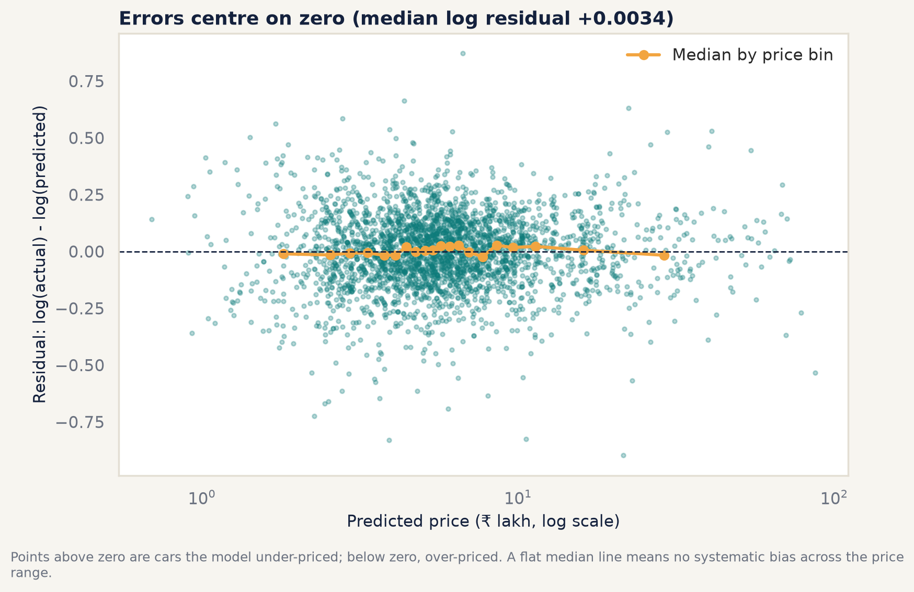

**Interval coverage.** The 80% range contains the true price for **79.96%** of test cars (2,438 of 3,049), with a 95% confidence interval of 78.5% to 81.34% that includes the nominal 80%: **well calibrated** [`interval_coverage.csv`]. Misses are balanced (10.07% below the range, 9.97% above). The median range is 38.44% of the predicted price wide. Calibration holds on average but not for every group: coverage is 92.45% for 0 to 2 year-old cars and only 52.38% for cars 12 years or older [`segment_errors.csv`].

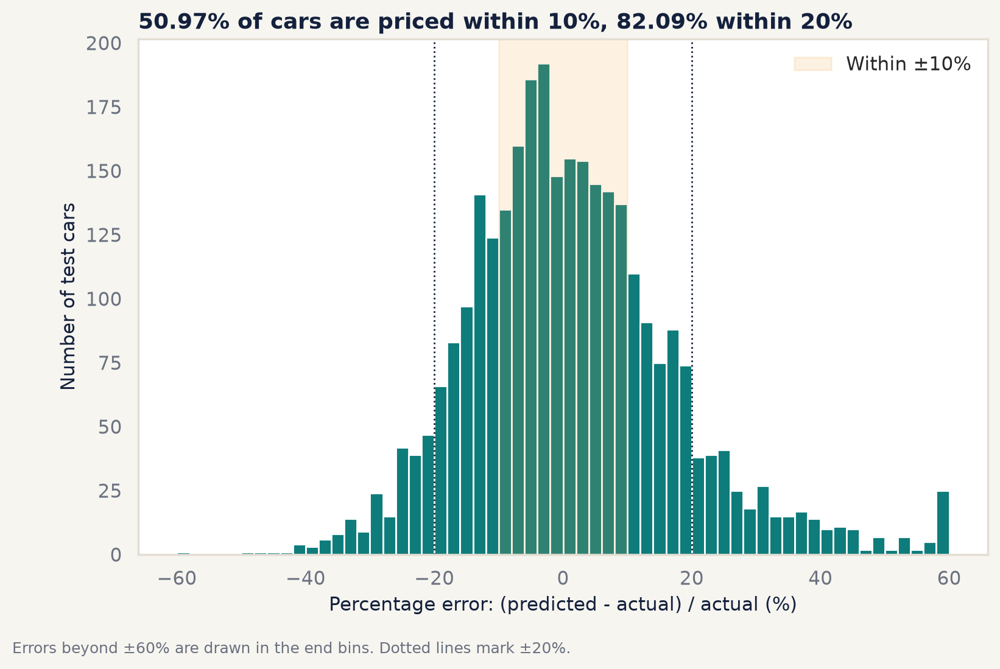

## Segment analysis

The test set was broken down by price band (training-set quintiles, so test data never define the bands), luxury band, brand, fuel, transmission, age band and seller (D-027). The five weakest segments, ranked by the share within 10% among segments with at least 30 test cars, are:

| Rank | Segment | Test cars | Within 10% | Median abs % error | Interval coverage |
|---|---|---|---|---|---|
| 1 | Vehicle age 12+ yrs | 168 | 32.74% | 18.9% | 52.38% |
| 2 | Vehicle age 9-11 yrs | 451 | 33.92% | 14.39% | 65.41% |
| 3 | Brand: BMW | 76 | 34.21% | 14.94% | 68.42% |
| 4 | Price band Q1 (₹ 0.4 to 3.5 lakh) | 650 | 39.23% | 12.96% | 68.92% |
| 5 | Above ₹ 20 lakh | 136 | 41.18% | 12.18% | 71.32% |

: The five weakest segments [`segment_errors.csv`]

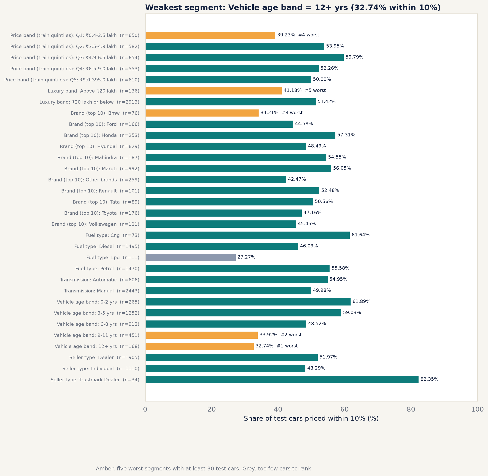

Three patterns stand out. **Accuracy falls with age**, from 61.89% within 10% at 0 to 2 years to 32.74% at 12 years and older: the condition of old cars varies much more and is not recorded. **The cheapest cars are over-priced** (median signed error +7.26% in Q1) and **luxury cars under-priced** (-5.76% above ₹ 20 lakh), both pulled towards the middle of the market. And **rare categories cannot be judged**: LPG has only 11 test cars. Strong segments include CNG cars (61.64% within 10%), Trustmark dealers (82.35%) and cars aged 0 to 5 years [`segment_errors.csv`].

**The largest errors.** The 20 largest rupee errors are 0.66% of test cars but 12.04% of all rupee error. Eighteen are luxury brands, 17 sell for over ₹ 20 lakh, all 20 are automatics and 18 fall outside their 80% range [`top_error_patterns.csv`]. The common cause is coarse model labels: the data record "Rover" for every Land Rover and "C" for a Mercedes-AMG C-class, so variants that differ by tens of lakhs look identical to the model [`top_errors.csv`].

## Explainability

Two independent methods agree on what drives the predictions.

**Permutation importance** (10 repeats on the test set) measures how much the test log RMSE rises when one input is shuffled: by 0.2854 for vehicle age, 0.2788 for car model and 0.117 for power; kilometres (0.023), transmission (0.0148) and brand (0.0137) matter much less, and `km_was_capped` has exactly zero effect, confirming it is not used (D-024) [`permutation_importance.csv`].

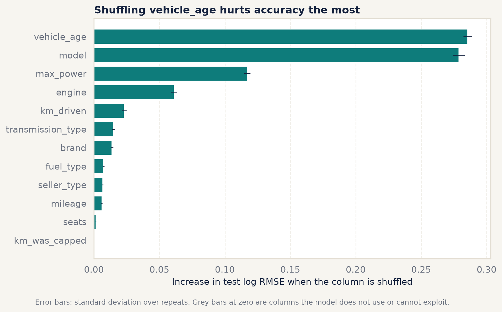

**SHAP** (TreeExplainer on 2,000 test cars, `evaluation.shap_sample_rows` in `configs/config.yaml`) attributes 30.41% of the total effect to the car model, 20.35% to age, 12.78% to power and 8.16% to engine size, with the engineered `age_x_power` next at 6.47% [`shap_importance.csv`].

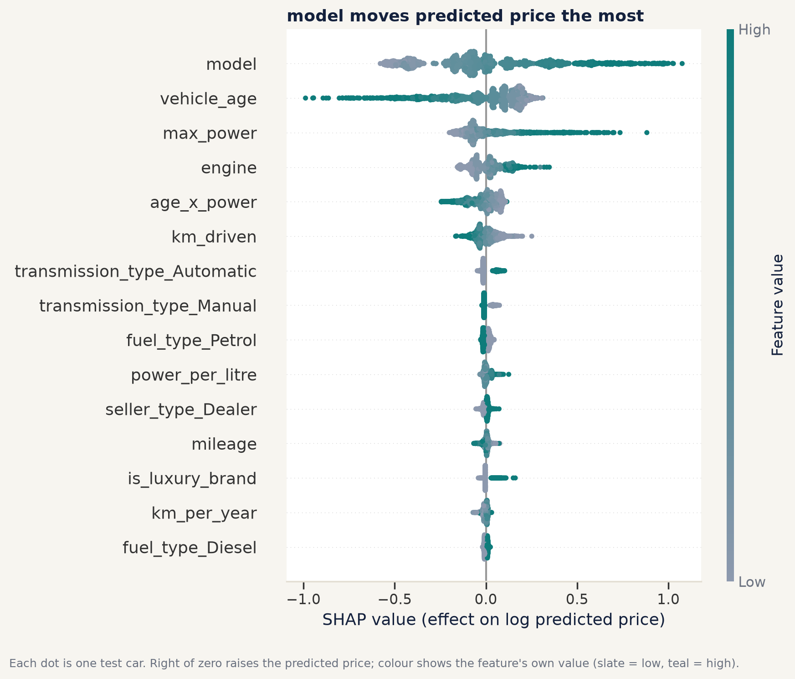

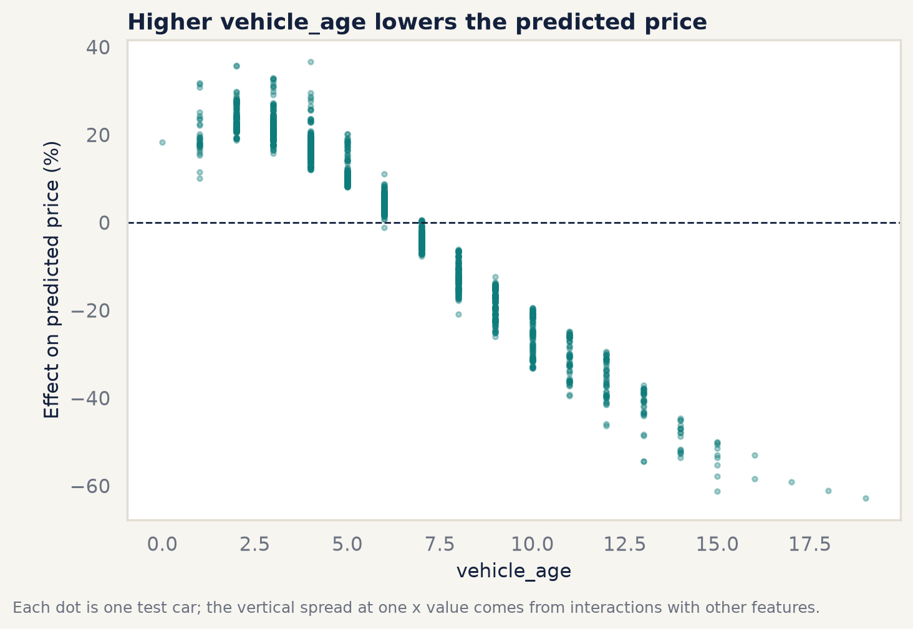

This matches the EDA: power, engine and age were the strongest numeric correlates of price. Transmission and fuel matter less to the model (SHAP shares 5.15% and 2.82% [`shap_importance.csv`]) than their raw price gaps suggest, because most of those gaps are explained by power, engine and the car model, which differ systematically between automatics and manuals or diesels and petrols.

# Prediction results

## Test-set predictions

Every one of the 3,049 test cars was scored with the saved pipeline and written to `reports/predictions/test_predictions.csv`, with the 80% range, the error and whether the input passes the GUI's validation rules. One test car, a Mercedes-AMG C, belongs to a brand absent from the training data; the GUI would refuse it, so it is scored without validation and flagged (D-030, D-031). The predictions are identical to those behind the Chapter 6 metrics.

## Worked examples

Ten real test cars illustrate the model (D-031). Eight are the typical car of a category, chosen by rule as the car whose error is closest to that category's median error, so the examples are representative rather than flattering; the last two are the single best and worst predictions.

| Category | Car | Actual | Predicted | Error | In 80% range |
|---|---|---|---|---|---|
| Cheap petrol hatchback | Datsun Redigo, 5 yrs | ₹ 2,35,000 | ₹ 2,63,272 | +12.03% | Yes |
| Family diesel SUV or MPV | Maruti Ertiga, 5 yrs | ₹ 8,11,000 | ₹ 7,18,623 | -11.39% | Yes |
| Old car (12+ years) | Hyundai Santro, 13 yrs | ₹ 1,20,000 | ₹ 1,42,660 | +18.88% | Yes |
| Luxury car | Jaguar XE, 4 yrs | ₹ 29,50,000 | ₹ 33,04,602 | +12.02% | Yes |
| CNG car | Maruti Eeco, 8 yrs | ₹ 3,25,000 | ₹ 2,98,398 | -8.19% | Yes |
| Automatic petrol city car | Honda City, 3 yrs | ₹ 11,50,000 | ₹ 10,72,861 | -6.71% | Yes |
| High-kilometre car | Hyundai i20, 1,50,000 km | ₹ 6,20,000 | ₹ 5,20,167 | -16.1% | Yes |
| Nearly new car | Renault Duster, 1 yr | ₹ 6,00,000 | ₹ 6,58,459 | +9.74% | Yes |
| Best prediction | Maruti Alto, 10 yrs | ₹ 1,85,000 | ₹ 1,84,967 | -0.02% | Yes |
| Worst prediction | Volkswagen Polo, 3 yrs | ₹ 8,75,000 | ₹ 21,47,143 | +145.39% | No |

: Worked examples [`reports/predictions/worked_examples.csv`]

Each example in `reports/predictions/worked_examples.md` has a generated explanation from that car's own TreeSHAP contributions. Two are worth describing here (figures from `reports/predictions/worked_examples.csv`):

- **Honda City (accurate).** A 3-year-old automatic with 606 training examples of its model. The biggest influences were its young age (+26%) and power (+13%); the estimate is 6.71% below the listing and well inside the range. [`reports/predictions/worked_examples.csv`]
- **Volkswagen Polo (worst).** The listing describes a 3-year-old Polo with a 1,798 cc, 189 bhp engine and an automatic gearbox, which matches a high-performance variant. The model, following the power (+89% influence), predicts ₹ 21,47,143, but the car listed at ₹ 8,75,000. Either the specification or the price is wrong, or the car has a problem the data cannot show. It is a reminder that the model trusts its inputs. [`reports/predictions/worked_examples.csv`]

## What-if analysis

To show how the model responds to age and kilometres, the most common car in the training data, a Maruti Swift Dzire with its typical specification, was priced on a grid of ages from 1 to 12 years and kilometre levels from 10,000 to 1,50,000 (`prediction.whatif_ages` and `whatif_km` in `configs/config.yaml`, D-031) [`reports/predictions/whatif_age_km.csv`]. At 10,000 km, the estimate falls from ₹ 7,66,034 at 1 year to ₹ 3,12,029 at 12 years. At a fixed age, extra kilometres reduce the price far less than extra years do, consistent with the weak kilometre correlation in the EDA.

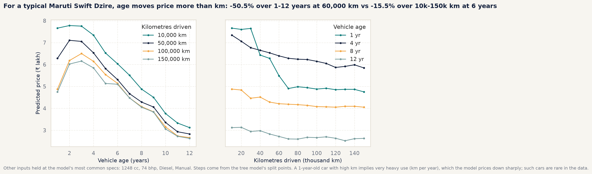

## Speed

The predictor must load in under 2.0 seconds and answer one car in under 100 ms (`prediction.max_load_seconds` and `max_single_prediction_ms` in `configs/config.yaml`). Timing is measured in five fresh processes by `python tasks.py predict` and written to `reports/tables/predictor_timing.csv`; on the development laptop on mains power every run passed both targets with a wide margin (D-044). Timings vary from machine to machine and run to run, so the exact values are not quoted here as results. An earlier measurement on battery in a power-saving plan was several times slower, which is why the targets are checked on both the fastest and the slowest of the five runs (D-031). The GUI's full response (validation, prediction, explanation and comparisons) is held to the 2.0-second budget by an automated test (`gui.max_response_seconds`, D-033).

# Graphical user interface

## Design rationale

The application is written in Streamlit and follows a fixed design system (A7 in `AGENTS.md`, D-035): a warm off-white background, white cards with thin borders, one teal primary colour, and a single amber highlight per view reserved for the most important element. Headings use Fraunces, body text Inter, and numbers JetBrains Mono. Prices appear in Indian digit grouping and in lakh, with units beside every value. Each chart has a title that states its finding and a sentence of interpretation beneath it, so no reading relies on colour alone. The app follows the visitor's light or dark system setting, with a dark palette derived from the same colours (D-036).

Three principles guided the layout. The task a visitor came for, pricing a car, is the first page and needs no scrolling. The estimate is never shown without its range and, where relevant, a warning in words. And no number is typed into the interface code: metrics are read from `reports/tables/` and the model card, and market figures are computed live from the cleaned data (D-032).

## Page walkthrough

**Price estimator** (default page). The form on the left (two fifths of the width) groups inputs into *Vehicle*, *Condition* and *Engine and fuel*. Brand and model are drop-down lists drawn from the training data, so an unseen brand or a model of another brand cannot be entered (D-030, D-034); choosing a model fills in its typical engine, power, mileage, seats and fuel, all still editable. Numeric inputs are bounded by the training range. Pressing **Estimate price** shows, on the right, the estimate as the largest element on the page, the 80% range as a bar with an amber marker, a message about similar listings, and a "Lower confidence" note when the car falls in a weak segment. Below are three panels: *Why this price* (the top five factors from TreeSHAP for this car), *Compare* (this car against the median of the same brand and age) and *What if* (the estimate as age or kilometres change). A second tab, *Batch estimate*, prices a whole CSV file with a downloadable template.

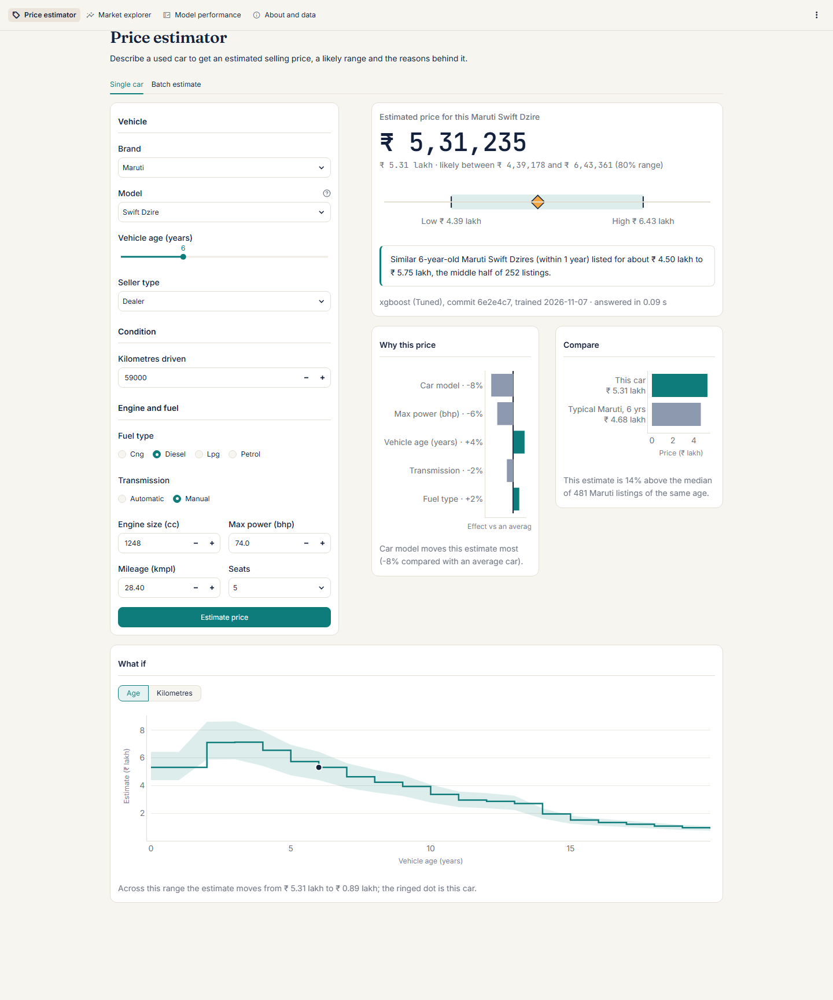

**Market explorer.** Filters for brand, fuel, transmission, age and price drive a summary strip (listings, median price, median age) and four charts: the price distribution, median price by age with a count-weighted trend, price against power by fuel, and top brands by median price.

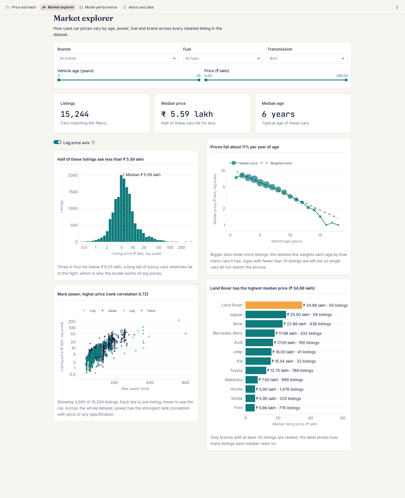

**Model performance.** Metric cards for the headline results, an interactive predicted-against-actual chart, the error distribution, segment accuracy with the weakest segment highlighted, the ten-algorithm comparison table and the SHAP summary with a plain-language paragraph.

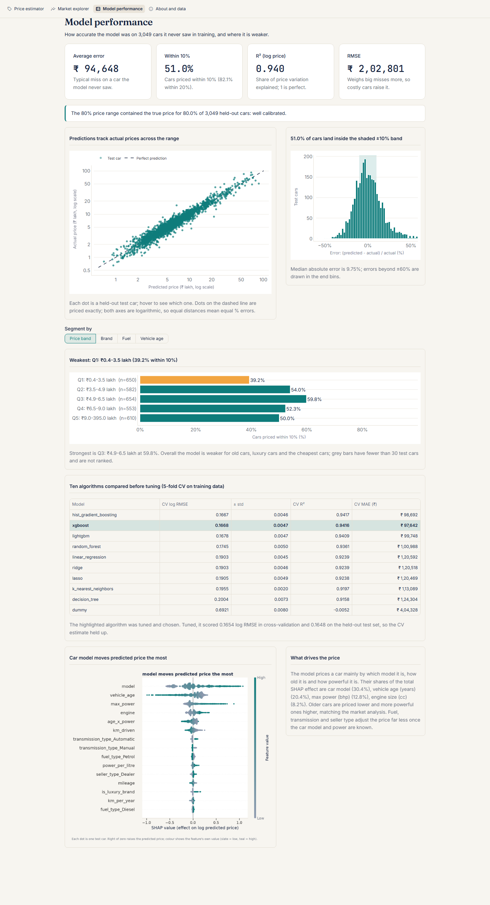

**About and data.** The dataset, the cleaning steps (from `cleaning_log.csv`), how the model works in four sentences, the limitations and the model card.

## User flow and states

A first-time visitor sees an estimate for the most common car immediately, so the page is never blank. They change the brand and model (the specification fills in), adjust age and kilometres, and press the button. If they change an input afterwards, an "Inputs changed" marker shows the result is stale rather than silently re-pricing. Every page has an empty state (for example, filters that match nothing), a loading state and an error state in plain language; Python tracebacks never reach the browser (`client.showErrorDetails = "none"`). On narrow screens the columns stack into one.

The interface is covered by automated tests (`tests/test_app_helpers.py`) that load all four pages, change the brand, check the pre-fill, press the button and check that an estimate with its explanation returns within the 2-second budget.

# Limitations, ethical considerations and future work

## Limitations

The final list of known limitations (D-026, D-042):

1. **Missing information.** The data contain no condition, accident or service history, number of owners, city, colour, trim or variant. These explain most of the remaining error, especially for old and luxury cars.
2. **Old cars.** For cars 9 years or older the model prices only about a third within 10% (33.92% at 9 to 11 years, 32.74% at 12+), against 50.97% overall [`segment_errors.csv`].
3. **Luxury and cheapest cars.** Cars above ₹ 20 lakh are under-priced by a median 5.76% and the cheapest quintile over-priced by 7.26%; 17 of the 20 largest errors are above ₹ 20 lakh [`segment_errors.csv`, `top_error_patterns.csv`].
4. **Interval calibrated only on average.** Coverage is 79.96% overall but 92.45% for cars up to 2 years and 52.38% for 12+ years.
5. **Rare categories.** LPG cars and brands outside the top ten have too few test cars to evaluate reliably; brands absent from training cannot be priced.
6. **Listing prices, not sale prices,** from one platform and one period.
7. **An unused input.** The `km_was_capped` flag is not a model input (D-024); with 12 affected rows the effect is nil.

## Ethical considerations

- **Use as guidance, not as a valuation.** An estimate that is wrong by 20% on an old car can cost a private seller a meaningful sum. The GUI therefore always shows the range, adds warnings in words for weak segments, and the About page states the limitations.
- **Fairness across brands and segments.** The model is most accurate for high-volume, mass-market brands and least accurate for rare brands, old cars and luxury cars. Owners of older, cheaper cars, who may be the least able to absorb a mispricing, receive the least reliable estimates; the cheapest quintile is also over-priced on average, which could mislead buyers of those cars. This is reported openly rather than hidden by removing difficult cars (D-007).
- **Data provenance.** The CarDekho data are used for academic purposes only. They contain no personal information about sellers.
- **Feedback loops.** If many sellers priced cars with this model, listing prices would drift towards its estimates and future training data would partly reflect the model itself.

## Future work

1. **Richer data:** trim and variant, condition, accident and ownership history, and city. This is where the largest gains lie.
2. **Intervals that adapt:** conformal or quantile-regression intervals that widen with age and price band, fixing limitation 4.
3. **Drift monitoring:** prices change with fuel prices, new models and the economy. A deployed version should compare live error against the test results and retrain on fresh data with a fresh hold-out set.
4. **Separate models or weighting for the luxury segment,** once more such data are available.
5. **Deployment** behind authentication with logging of predictions, so that real-world accuracy can be measured.

# Conclusion

The project met its four requirements. The raw data were audited and cleaned by logged, justified rules that removed only 167 duplicate rows. The exploratory analysis established that price is heavily skewed, that power, engine, age and the car model drive it, and that relationships are curved and interacting; it led directly to a log target, measured engineered features and a preference for tree ensembles. Ten algorithms were compared fairly by cross-validation on training data only, the boosters were tuned, and a tuned XGBoost pipeline was chosen by a rule fixed in advance. On a locked test set scored once it achieved an average error of ₹ 94,648, priced 50.97% of cars within 10% and 82.09% within 20%, beat the Ridge baseline by a margin the bootstrap shows is real, and matched its cross-validation estimate, with an 80% range that is well calibrated overall.

The model is fit for its intended purpose as a first-opinion price guide for mainstream cars, and it says so less confidently, in words, where it is weak: old cars, luxury cars, the cheapest cars and rare models. Its main limitation is the data rather than the algorithm, and the most valuable next step would be richer information about each car's variant and condition.

# Appendix A: Decision log summary {.unnumbered}

The full log with options considered, evidence and how to reverse each choice is in `decisions.md`.

| Id | Decision |
|---|---|
| D-001 | Fixed tech stack: `Python 3.11`, pinned requirements, scikit-learn, XGBoost, LightGBM, Optuna, SHAP, Streamlit |
| D-002 | Modular repository; raw data read-only |
| D-003 | Drop 167 exact duplicates; keep same-spec rows with different prices |
| D-004 | Cap odometer at 5,00,000 km with a flag |
| D-005 | Recode four "Electric" Camry hybrids to Petrol |
| D-006 | Impute two zero-seat rows from the brand/model mode |
| D-007 | Keep genuine luxury cars; evaluate by segment |
| D-008 | Drop identifier columns; validate schema at every stage |
| D-009 | Model `log1p(price)` |
| D-010 | Feature proposals from the EDA (later measured in D-013) |
| D-011 | Non-parametric hypothesis tests with effect sizes |
| D-012 | Stratified 80/20 split on price quintiles, seed 42 |
| D-013 | Keep four engineered features by measured CV gain |
| D-014 | Target-encode `model` (better for XGBoost) |
| D-015 | Group rare brands per fold; brand tiers for reporting only |
| D-016 | Ten-algorithm shortlist |
| D-017 | `TransformedTargetRegressor` around the whole pipeline |
| D-018 | Optuna TPE, 35 trials per booster, precomputed folds |
| D-019 | Lowest CV log RMSE wins: tuned XGBoost |
| D-020 | 80% interval from out-of-fold residual quantiles |
| D-021 | Phase 4 consistency review and corrections |
| D-022 | Pre-split steps assessed for leakage |
| D-023 | Metrics and headline fixed before test scoring |
| D-024 | `km_was_capped` not a model input; left unchanged |
| D-025 | Test set scored once; no post-hoc changes |
| D-026 | Known limitations from the test evaluation |
| D-027 | Evaluation implementation choices |
| D-028 | Resolution of Phase 4 and 5 open questions |
| D-029 | Prediction input validation rules |
| D-030 | Strict brand/model consistency |
| D-031 | Prediction outputs, worked-example rules, timing method |
| D-032 | GUI page structure and architecture |
| D-033 | Native TreeSHAP in the app; response time |
| D-034 | Rare and luxury cars in the UI |
| D-035 | Design system implementation |
| D-036 | Dark mode |
| D-037 | Phase 8 reproducibility audit and build fixes |
| D-038 | EDA notebook display fix and audit of Phase 1 and 2 figures |
| D-039 | Number provenance checks and derived-figure table |
| D-040 | Report export toolchain |
| D-041 | Final model and why (confirmation) |
| D-042 | Final list of known limitations |
| D-043 | Scope not delivered |
| D-044 | Resolution of the remaining open questions |

: Decision log summary

# Appendix B: Repository map {.unnumbered}

```text
configs/config.yaml          every path, seed, threshold, grid and search space
data/raw/                    the read-only CarDekho CSV
data/interim/                cars_clean.csv (generated)
data/processed/              train.csv, test.csv (generated), split_indices.json
src/carprice/                the package
  config.py                  typed settings loaded from the YAML
  data.py                    load, validate, audit, clean (Phase 1)
  viz.py, palette.py         shared plot style and EDA figures (Phase 2)
  features.py                split, engineered features, ColumnTransformer (Phase 3)
  train.py                   CV benchmark, Optuna tuning, final fit (Phase 4)
  evaluate.py, eval_plots.py test metrics, segments, bootstrap, SHAP (Phase 5)
  predict.py, insights.py    validated predictor, explanations, what-if (Phase 6)
  prediction_reports.py      Phase 6 output files
  formatting.py, market.py   rupee formatting; market summaries for the GUI
  report_facts.py            derived figures for this report (Phase 8)
  provenance.py              number-to-source checks (Phase 8)
app/                         Streamlit app: Home.py, pages/, components/
models/                      final_pipeline.joblib (generated), model card, schema
notebooks/                   01 data audit, 02 EDA, 03 model evaluation
reports/figures/, tables/    every figure and table used here
reports/predictions/         test predictions, worked examples, what-if grid
scripts/                     screenshots, report export, run comparison
tests/                       pytest suite
```

# Appendix C: How to reproduce {.unnumbered}

From a fresh clone with `Python 3.11` (full details and timings in `README.md` and `reports/reproducibility_check.md`):

```bash
make setup        # or: python tasks.py setup      (creates .venv, installs requirements)
make all          # or: python tasks.py all        (clean data, EDA, split, train, evaluate, predict)
make test         # or: python tasks.py test
make app          # or: python tasks.py app        (streamlit run app/Home.py)
make report       # or: python tasks.py report     (this report to .docx and .pdf)
```

On Windows without `make`, the `python tasks.py` commands do the same. Each step reads its settings from `configs/config.yaml` and uses seed 42, so the numbers in this report are reproduced; only run times differ between machines.

# Appendix D: Source of every number {.unnumbered}

Every number quoted in this report, in order of first appearance, with the file it was matched to. The table is generated by `python -m carprice.provenance reports/final_report.md`, and `tests/test_provenance.py` fails if any number lacks a source or if this table is out of date. Whole numbers up to 12 (list positions, "5-fold", "Q1"), file names, commands, dates and decision ids are not listed. Each number is matched to a file cited beside it in the text (a table caption counts for its table); file names without a folder are in `reports/tables/`. A number that could only be matched by searching all files would be marked with an asterisk; the test requires there to be none.

<!-- number-sources:start -->

| Number | Source | Number | Source |
|---|---|---|---|
| 15,411 | `cleaning_log.csv` | 167 | `cleaning_log.csv` |
| 18 | `report_key_figures.csv` | 15,244 | `cleaning_log.csv` |
| 80 | `configs/config.yaml` | 20 | `test_metrics.csv` |
| 3,049 | `test_metrics.csv` | 0.1654 | `models/best_params.json` |
| 94,648 | `test_metrics.csv` | 95 | `bootstrap_ci.csv` |
| 88,440 | `bootstrap_ci.csv` | 1,01,444 | `bootstrap_ci.csv` |
| 50.97 | `bootstrap_ci.csv` | 82.09 | `test_metrics.csv` |
| 18.30 | `report_key_figures.csv` | 79.96 | `interval_coverage.csv` |
| 42 | `configs/config.yaml` | 14 | `report_key_figures.csv` |
| 32 | `audit_schema.csv` | 120 | `audit_schema.csv` |
| 29 | `audit_numeric_summary.csv` | 40,000 | `audit_numeric_summary.csv` |
| 3.95 | `audit_numeric_summary.csv` | 5.56 | `audit_numeric_summary.csv` |
| 99 | `audit_numeric_summary.csv` | 1,80,000 | `audit_numeric_summary.csv` |
| 38,00,000 | `audit_numeric_summary.csv` | 5,00,000 | `audit_logical_checks.csv` |
| 2,494 | `audit_electric_rows.csv` | 157.7 | `audit_electric_rows.csv` |
| 1.084 | `audit_duplicates.csv` | 2,148 | `audit_duplicates.csv` |
| 9,539 | `audit_categorical_frequencies.csv` | 5,699 | `audit_categorical_frequencies.csv` |
| 79.326 | `audit_categorical_frequencies.csv` | 44 | `audit_categorical_frequencies.csv` |
| 13 | `audit_categorical_frequencies.csv` | 1,00,000 | `audit_logical_checks.csv` |
| 105 | `audit_logical_checks.csv` | 30 | `audit_logical_checks.csv` |
| 175 | `audit_logical_checks.csv` | 50,000 | `audit_logical_checks.csv` |
| 3,344 | `cleaning_log.csv` | 12,195 | `models/model_card.json` |
| 10.11 | `report_key_figures.csv` | 0.56 | `report_key_figures.csv` |
| 5.59 | `eda_numeric_summary.csv` | 8.25 | `eda_numeric_summary.csv` |
| 7.75 | `eda_numeric_summary.csv` | 32.36 | `report_key_figures.csv` |
| 19.36 | `report_key_figures.csv` | 51.73 | `report_key_figures.csv` |
| 79.34 | `report_key_figures.csv` | 49.59 | `report_key_figures.csv` |
| 48.16 | `report_key_figures.csv` | 83.76 | `report_key_figures.csv` |
| 31 | `report_key_figures.csv` | 0.72 | `eda_spearman_correlation.csv` |
| 0.64 | `eda_spearman_correlation.csv` | 0.76 | `eda_pearson_correlation.csv` |
| 0.48 | `eda_spearman_correlation.csv` | 9.39 | `eda_depreciation_rates.csv` |
| 12.89 | `eda_depreciation_rates.csv` | 0.17 | `eda_spearman_correlation.csv` |
| 0.58 | `eda_spearman_correlation.csv` | 10,50,000 | `eda_transmission_medians.csv` |
| 2.10 | `report_key_figures.csv` | 7,00,000 | `eda_fuel_medians.csv` |
| 4,60,000 | `eda_fuel_medians.csv` | 1.52 | `report_key_figures.csv` |
| 5,90,000 | `eda_seller_medians.csv` | 5,10,000 | `eda_seller_medians.csv` |
| 1.16 | `report_key_figures.csv` | 3,00,000 | `eda_brand_medians.csv` |
| 12,75,000 | `eda_brand_medians.csv` | 22,87,500 | `eda_brand_medians.csv` |
| 50,00,000 | `eda_brand_medians.csv` | 0.81 | `eda_pearson_correlation.csv` |
| 0.83 | `eda_spearman_correlation.csv` | 6.41 | `eda_vif_summary.csv` |
| 4.56 | `eda_vif_summary.csv` | 1.43 | `eda_vif_summary.csv` |
| 2.27 | `eda_vif_summary.csv` | 4,49,500 | `eda_hypothesis_tests.csv` |
| 3,40,000 | `eda_hypothesis_tests.csv` | 38 | `eda_hypothesis_tests.csv` |
| 74 | `eda_hypothesis_tests.csv` | 0.001 | `eda_hypothesis_tests.csv` |
| 0.26 | `eda_hypothesis_tests.csv` | 0.61 | `eda_hypothesis_tests.csv` |
| 0.18 | `eda_hypothesis_tests.csv` | 2527.5 | `eda_hypothesis_tests.csv` |
| 0.32 | `eda_hypothesis_tests.csv` | 0.0001 | `configs/config.yaml` |
| 0.202 | `feature_checks.csv` | 0.2018 | `feature_checks.csv` |
| 0.0002 | `feature_checks.csv` | 0.2016 | `feature_checks.csv` |
| 0.0005 | `feature_checks.csv` | 0.2025 | `feature_checks.csv` |
| 0.0004 | `feature_checks.csv` | 0.2009 | `feature_checks.csv` |
| 0.0011 | `feature_checks.csv` | 0.1925 | `feature_checks.csv` |
| 0.0095 | `feature_checks.csv` | 0.2021 | `feature_checks.csv` |
| 0.0 | `feature_checks.csv` | 0.1903 | `feature_checks.csv` |
| 0.0117 | `feature_checks.csv` | 0.1673 | `encoder_comparison.csv` |
| 0.1895 | `encoder_comparison.csv` | 0.1667 | `cv_results.csv` |
| 0.0046 | `cv_results.csv` | 0.9417 | `cv_results.csv` |
| 98,692 | `cv_results.csv` | 0.1668 | `cv_results.csv` |
| 0.0047 | `cv_results.csv` | 0.9416 | `cv_results.csv` |
| 97,642 | `cv_results.csv` | 0.1678 | `cv_results.csv` |
| 0.9409 | `cv_results.csv` | 99,748 | `cv_results.csv` |
| 0.1745 | `cv_results.csv` | 0.005 | `cv_results.csv` |
| 0.9361 | `cv_results.csv` | 1,00,988 | `cv_results.csv` |
| 0.0045 | `cv_results.csv` | 0.9239 | `cv_results.csv` |
| 1,20,592 | `cv_results.csv` | 1,20,518 | `cv_results.csv` |
| 0.1905 | `cv_results.csv` | 0.0049 | `cv_results.csv` |
| 0.9238 | `cv_results.csv` | 1,20,469 | `cv_results.csv` |
| 0.1955 | `cv_results.csv` | 0.002 | `cv_results.csv` |
| 0.9197 | `cv_results.csv` | 1,13,089 | `cv_results.csv` |
| 0.2004 | `cv_results.csv` | 0.0073 | `cv_results.csv` |
| 0.9158 | `cv_results.csv` | 1,24,304 | `cv_results.csv` |
| 0.6921 | `cv_results.csv` | 0.008 | `cv_results.csv` |
| 0.0052 | `cv_results.csv` | 4,04,328 | `cv_results.csv` |
| 35 | `configs/config.yaml` | 0.1660 | `models/best_params.json` |
| 0.9426 | `models/model_card.json` | 200 | `models/model_card.json` |
| 0.05 | `models/model_card.json` | 0.86 | `models/model_card.json` |
| 0.68 | `models/model_card.json` | 76.1 | `models/model_card.json` |
| 13.06 | `models/model_card.json` | 90 | `models/model_card.json` |
| 0.1915 | `models/model_card.json` | 1,000 | `bootstrap_ci.csv` |
| 1,15,850 | `test_metrics.csv` | 3,85,255 | `test_metrics.csv` |
| 2,02,801 | `test_metrics.csv` | 2,66,575 | `test_metrics.csv` |
| 8,07,416 | `test_metrics.csv` | 0.9328 | `test_metrics.csv` |
| 0.9319 | `test_metrics.csv` | 0.8839 | `test_metrics.csv` |
| 0.8824 | `test_metrics.csv` | 0.0654 | `test_metrics.csv` |
| 0.1247 | `test_metrics.csv` | 0.1457 | `test_metrics.csv` |
| 0.5016 | `test_metrics.csv` | 0.1648 | `test_metrics.csv` |
| 0.1881 | `test_metrics.csv` | 0.6732 | `test_metrics.csv` |
| 0.9399 | `test_metrics.csv` | 0.9391 | `test_metrics.csv` |
| 0.9216 | `test_metrics.csv` | 0.9206 | `test_metrics.csv` |
| 0.0036 | `test_metrics.csv` | 12.7 | `test_metrics.csv` |
| 14.86 | `test_metrics.csv` | 53.67 | `test_metrics.csv` |
| 9.75 | `test_metrics.csv` | 12.04 | `test_metrics.csv` |
| 37.08 | `test_metrics.csv` | 42.93 | `test_metrics.csv` |
| 14.43 | `test_metrics.csv` | 75.11 | `test_metrics.csv` |
| 29.94 | `test_metrics.csv` | 0.34 | `test_metrics.csv` |
| 0.65 | `test_metrics.csv` | 1.08 | `test_metrics.csv` |
| 12.39 | `report_key_figures.csv` | 8.04 | `report_key_figures.csv` |
| 28,252 | `bootstrap_ci.csv` | 14,851 | `bootstrap_ci.csv` |
| 75.43 | `report_key_figures.csv` | 0.1387 | `train_vs_test.csv` |
| 0.9596 | `train_vs_test.csv` | 0.36 | `train_vs_test.csv` |
| 0.0009 | `residual_stats.csv` | 0.0034 | `residual_stats.csv` |
| 1.875 | `residual_stats.csv` | 5.21 | `residual_stats.csv` |
| 4.55 | `residual_stats.csv` | 2,438 | `interval_coverage.csv` |
| 78.5 | `interval_coverage.csv` | 81.34 | `interval_coverage.csv` |
| 10.07 | `interval_coverage.csv` | 9.97 | `interval_coverage.csv` |
| 38.44 | `interval_coverage.csv` | 92.45 | `segment_errors.csv` |
| 52.38 | `segment_errors.csv` | 168 | `segment_errors.csv` |
| 32.74 | `segment_errors.csv` | 18.9 | `segment_errors.csv` |
| 451 | `segment_errors.csv` | 33.92 | `segment_errors.csv` |
| 14.39 | `segment_errors.csv` | 65.41 | `segment_errors.csv` |
| 76 | `segment_errors.csv` | 34.21 | `segment_errors.csv` |
| 14.94 | `segment_errors.csv` | 68.42 | `segment_errors.csv` |
| 0.4 | `segment_errors.csv` | 3.5 | `segment_errors.csv` |
| 650 | `segment_errors.csv` | 39.23 | `segment_errors.csv` |
| 12.96 | `segment_errors.csv` | 68.92 | `segment_errors.csv` |
| 136 | `segment_errors.csv` | 41.18 | `segment_errors.csv` |
| 12.18 | `segment_errors.csv` | 71.32 | `segment_errors.csv` |
| 61.89 | `segment_errors.csv` | 7.26 | `segment_errors.csv` |
| 5.76 | `segment_errors.csv` | 61.64 | `segment_errors.csv` |
| 82.35 | `segment_errors.csv` | 0.66 | `top_error_patterns.csv` |
| 17 | `top_error_patterns.csv` | 0.2854 | `permutation_importance.csv` |
| 0.2788 | `permutation_importance.csv` | 0.117 | `permutation_importance.csv` |
| 0.023 | `permutation_importance.csv` | 0.0148 | `permutation_importance.csv` |
| 0.0137 | `permutation_importance.csv` | 2,000 | `configs/config.yaml` |
| 30.41 | `shap_importance.csv` | 20.35 | `shap_importance.csv` |
| 12.78 | `shap_importance.csv` | 8.16 | `shap_importance.csv` |
| 6.47 | `shap_importance.csv` | 5.15 | `shap_importance.csv` |
| 2.82 | `shap_importance.csv` | 2,35,000 | `reports/predictions/worked_examples.csv` |
| 2,63,272 | `reports/predictions/worked_examples.csv` | 12.03 | `reports/predictions/worked_examples.csv` |
| 8,11,000 | `reports/predictions/worked_examples.csv` | 7,18,623 | `reports/predictions/worked_examples.csv` |
| 11.39 | `reports/predictions/worked_examples.csv` | 1,20,000 | `reports/predictions/worked_examples.csv` |
| 1,42,660 | `reports/predictions/worked_examples.csv` | 18.88 | `reports/predictions/worked_examples.csv` |
| 29,50,000 | `reports/predictions/worked_examples.csv` | 33,04,602 | `reports/predictions/worked_examples.csv` |
| 12.02 | `reports/predictions/worked_examples.csv` | 3,25,000 | `reports/predictions/worked_examples.csv` |
| 2,98,398 | `reports/predictions/worked_examples.csv` | 8.19 | `reports/predictions/worked_examples.csv` |
| 11,50,000 | `reports/predictions/worked_examples.csv` | 10,72,861 | `reports/predictions/worked_examples.csv` |
| 6.71 | `reports/predictions/worked_examples.csv` | 1,50,000 | `reports/predictions/worked_examples.csv` |
| 6,20,000 | `reports/predictions/worked_examples.csv` | 5,20,167 | `reports/predictions/worked_examples.csv` |
| 16.1 | `reports/predictions/worked_examples.csv` | 6,00,000 | `reports/predictions/worked_examples.csv` |
| 6,58,459 | `reports/predictions/worked_examples.csv` | 9.74 | `reports/predictions/worked_examples.csv` |
| 1,85,000 | `reports/predictions/worked_examples.csv` | 1,84,967 | `reports/predictions/worked_examples.csv` |
| 0.02 | `reports/predictions/worked_examples.csv` | 8,75,000 | `reports/predictions/worked_examples.csv` |
| 21,47,143 | `reports/predictions/worked_examples.csv` | 145.39 | `reports/predictions/worked_examples.csv` |
| 606 | `reports/predictions/worked_examples.csv` | 26 | `reports/predictions/worked_examples.csv` |
| 1,798 | `reports/predictions/worked_examples.csv` | 189 | `reports/predictions/worked_examples.csv` |
| 89 | `reports/predictions/worked_examples.csv` | 10,000 | `reports/predictions/whatif_age_km.csv` |
| 7,66,034 | `reports/predictions/whatif_age_km.csv` | 3,12,029 | `reports/predictions/whatif_age_km.csv` |
| 2.0 | `configs/config.yaml` | 100 | `configs/config.yaml` |

<!-- number-sources:end -->
